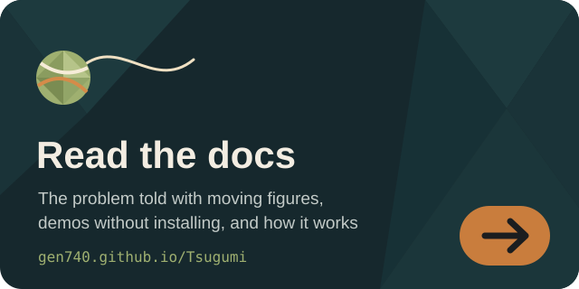
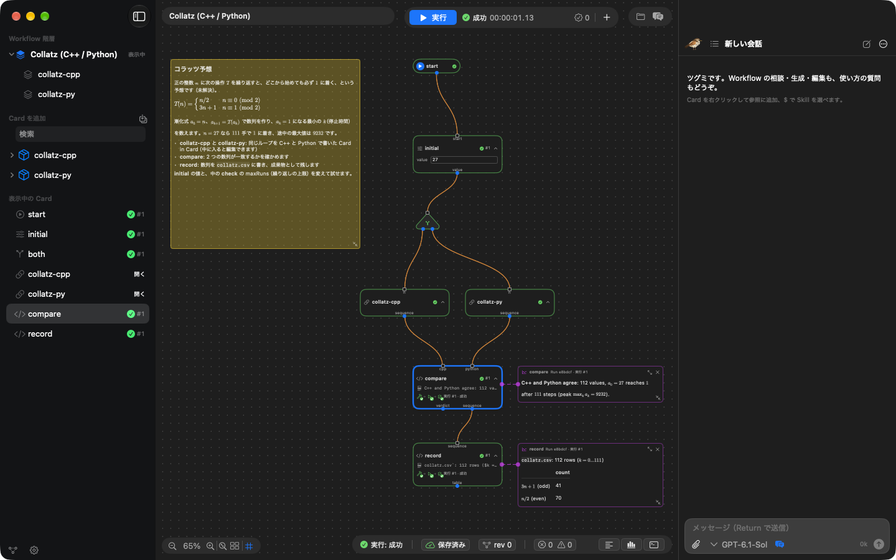
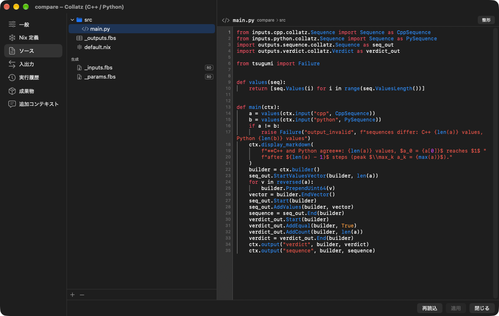
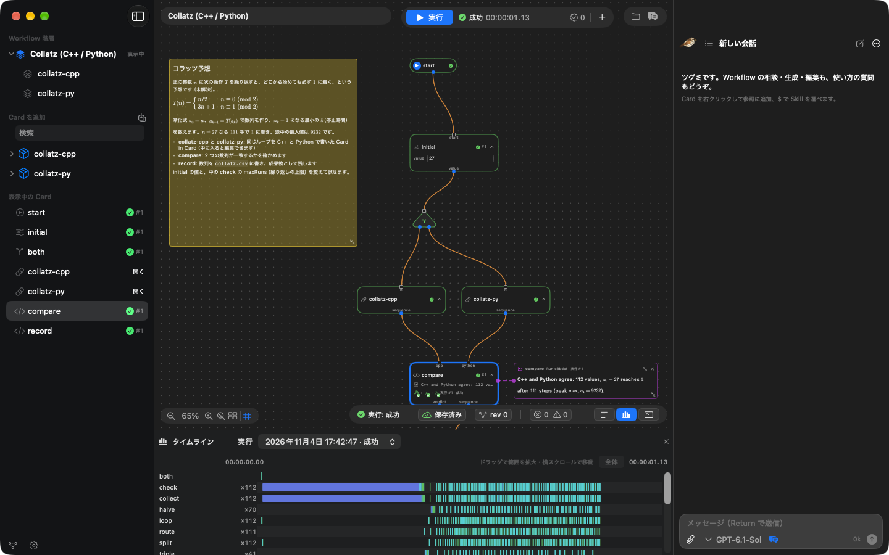
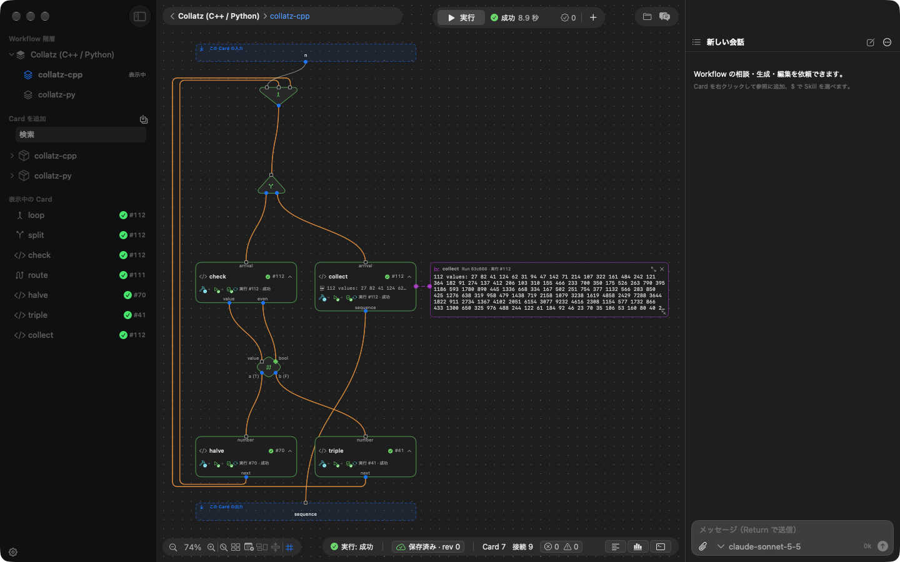
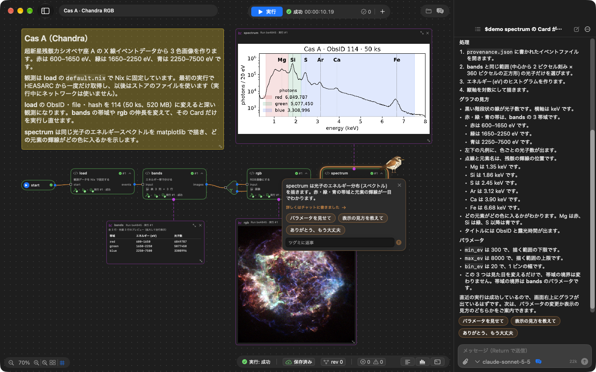

<p align="center">
  <a href="https://gen740.github.io/Tsugumi/"></a>
</p>

<p align="center">
  <a href="https://gen740.github.io/Tsugumi/"></a>
</p>

<p align="center">
  <a href="https://gen740.github.io/Tsugumi/"></a>
  <a href="https://github.com/gen740/Tsugumi/actions/workflows/ci.yml"></a>
  <a href="https://github.com/gen740/Tsugumi/releases/latest"></a>
  <a href="LICENSE"></a>
  <a href="INSTALL.md"></a>
  <a href="docs/Provenance.md"></a>
  <a href="docs/Provenance.md"></a>
  <a href="docs/llms.txt"></a>
</p>

# Tsugumi

**AI と描いた解析を、そのまま動かし、自分の手で確かめる。**

Tsugumi は、人間が描く仕様、AI が編集する対象、実際に動く処理を、同じ Workflow として扱う macOS の研究ワークベンチです。
計算やデータ処理を Card とその接続で描き、AI とともに実装して、Nix で固定した環境で実行します。
気になる Card のコードや結果を開き、条件を変え、保存された入力でもう一度試す。その往復を通じて、研究者が解析の過程を理解し、次の問いを立てられるようにします。



<p align="center">
  <a href="#使ってみる"><b>使ってみる</b></a> ·
  <a href="#画面でたどる実験と検証">画面でたどる</a> ·
  <a href="#ドキュメント">ドキュメント</a> ·
  <a href="docs/Philosophy.md">なぜ作ったか</a> ·
  <a href="docs/Name.md">名前の由来</a> ·
  <a href="https://gen740.github.io/Tsugumi/">動く図で読む</a>
</p>

- **描いた図が、そのまま動く。** Draft を線でつなぐと、Agent がコード・型・Nix の環境定義を作り、その Workflow がそのまま実行されます。
- **気になった Card だけを、すぐ試す。** 保存された入力を使って、選んだ Card や子 Workflow だけを再実行できます。
- **環境ごと固定して、確かめ直せる。** Card ごとの依存関係を Nix で固定し、実行は git の版と結びつけて記録します。
- **計算は Mac の中の隔離された VM で。** Card からの外部ネットワークは既定で遮断し、Agent に送られる内容も[明示](docs/security.md#モデルに送られるもの)しています。
- **完成した Workflow に LLM は要らない。** 生成されたコードは通常のファイルとして残り、人間がいつでも読んで直せます。

## AI を研究に積極的に活用できていますか？

AI は、数学や科学の長年の難問に挑み始めています。
2026 年 8 月から 9 月にかけて、OpenAI は [10 件の未解決問題の解決または大幅な前進](https://openai.com/index/ten-advances-in-mathematics/)を、Anthropic の Claude は[リーマンゼータ関数の下界更新](https://www.anthropic.com/research/riemann-zeta)と[フェルマーの最終定理の完全形式化](https://www.anthropic.com/research/formalizing-fermats-last-theorem)を発表しました。どれも議論を証明支援系 Lean などで形式化し、コンピュータが[機械的に検証](https://lean-lang.org/doc/reference/latest/ValidatingProofs/)できる証明として公開しています。
10 月には、物理学者 Matthew Schwartz と Anthropic が、厳密に検証できる計算ハーネスの中で Claude を動かし、数十年間解けなかった素粒子物理の積分計算を突破しました（[Claude-shaped science](https://www.anthropic.com/news/claude-shaped-science)）。

人間が成果を吟味し、意味を理解して、次の問いを立てられるのは、AI の議論や計算を独立した仕組みで確かめられるからです。

**AI に仕事を任せるには、その仕事を確かめられる仕組みが必要です。**

では、日々の研究で AI にもっと多くの仕事を任せるのをためらってしまうのは、なぜでしょうか。

1. **再現性を担保できない。** 結果を生んだコード・入力・実行環境が揃っておらず、同じ計算をもう一度確かめられない。
2. **結論に至るプロセスが見えない。** どのデータにどんな処理を施し、どこで何を判断したのかを追えない。
3. **データを AI に渡すのが怖い。** 未公開のデータがどこへ送られ、どう扱われるのかを把握できない。

これらに共通しているのは、**AI が何を行い、何を扱ったのかを、人間が後から追って確かめるための足場がない**という問題です。

## 確かめるたびに、次の問いが生まれる

AI の登場によって、コードを書き、実験を回し、結果をまとめるまでの時間は劇的に短くなりました。
その間に何を試し、何が分かったのかも、整った要約やレポートとしてすぐに受け取れます。
しかし、試行錯誤が速く、大規模になるほど、言葉でまとめられた報告と実際の処理を照らし合わせることは難しくなっていきます。

「この条件だけ変えたら、結果はどう変わるだろう」
「ここだけ、別のアプローチを試してみたい」

そう思うたびにまた新しい試行を頼み、返ってきた長いレポートを読み直す。
何千行ものコードや説明の中から、いつの間にか変わった前提を探し、結論の根拠を確かめる——。
実験そのものは速く回せても、人間がその過程を消化し、次の発想へとつなげる段階で足が止まってしまいます。

**結果を吟味し、何を根拠として採用し、次に何を問うかを決める。それは、他ならぬ研究者が担う仕事です。**
検証は、新しい発想が生まれる創造的な場でもあります。
背景の推定方法を変えても、同じ傾向が見えるだろうか。別のモデルなら、説明できなかった差を説明できるだろうか。
条件を変えて結果を比べるたびに、仮説の成り立つ範囲が見え、次に調べたいことが生まれます。

Tsugumi では、その疑問が生まれた箇所に直接手を入れられます。
Card のコードを読み、パラメータを変え、保存された入力で試す。版の履歴から以前の方針へ戻り、別のアプローチを始める。
部分実行で調整を進め、最後は Workflow 全体を通して結果を確かめます。

**解析の過程を理解することから、自分の問いを試すことへ。その距離を短くしたい。**
AI と重ねた試行錯誤を見渡せる構造に残し、研究者が仮説と結果を深く考えるための時間と、次の試行へ進む余地を広げます。

## AI に頼みたいことは、本来単純なはずです

観測データをダウンロードして、エネルギーで区切って、描画する。
やりたいことは、紙に箱を三つ描けば伝わるくらい単純です。
それなのに今は、長い指示を書き、長いレポートを読み、伝わったかどうかを確かめ直しています。

## 処理の形を描く。AI と実装する。実行して確かめる。

Tsugumi は、計算やデータ処理を **Card のグラフ（Workflow）として組み立てる macOS アプリ**です。

1. **描く。** 名前と内容だけの Draft を置き、線でつないで全体の流れを設計します。
2. **実装する。** Agent に Draft の実装を任せることも、自分で C++ / Python / bash を書くこともできます。生成されたコードは通常のファイルとしてプロジェクトに残り、いつでも読み直して編集できます。実際の Claude API で Draft から実行・検証までを通した記録は [AgentRun.md](docs/AgentRun.md) にあります。
3. **確かめる。** Nix で固定された環境でグラフを実行し、各 Card の進捗・出力・ログを確認します。途中の処理を直したら、保存された入力を使ってその箇所からすぐに再実行できます。

## 処理を細かく分けても、試行錯誤を重くしない

研究者が解析を理解し、途中の判断を確かめるには、処理が手を入れられる大きさに分かれている必要があります。一方、細かく分けるほど、入出力の型や実行環境を整える手間、処理の起動や記録にかかる時間も増えます。

Tsugumi は、この負担を Agent と実行基盤で引き受けます。

| 研究者がしたいこと | それを支える工夫 |
| --- | --- |
| 処理の意図と関係を示して、実装を任せる | Draft の説明と接続を Agent が読み、コード・出力型・Nix の環境定義を作ります。下流の入力型は接続から導出します。 |
| 条件を変えて、繰り返し試す | 実行時パラメータとビルド入力を分け、条件変更による不要な再ビルドを避けます。Nix 評価器と worker も再利用します。 |
| 気になった処理だけを確かめる | 最新の入力を保存し、選択した Card や子 Workflow の部分実行に使います。ファイルの実体も保持し、再実行前に入力の型を確認します。 |
| 実際に何が動いたかを追う | 出力の検証と実行記録の保存を終えてから、完了を通知して下流へ値を渡します。記録した値には当時の型情報も残します。 |

この設計により、研究者は結果から処理へ戻り、その箇所を変更して、保存された入力で試せます。部分実行で調整した後は、Workflow 全体を通して結果を確かめます。

**人間が描いた構造、Agent が実装する構造、実際に動く構造は同じです。**
生成されたコードは通常のファイルとして残り、完成した Workflow の実行に LLM は必要ありません。個々の工夫の理由と実装・テストへの案内は、[試行錯誤を支える実装上の工夫](docs/novelty.md#試行錯誤を支える実装上の工夫)にまとめています。

## 画面でたどる、実験と検証

同梱の「Cas A · Chandra RGB」デモでは、超新星残骸カシオペヤ座 A の X 線観測（Chandra）を Nix で固定して取得し、光子を 3 つのエネルギー帯に分けて RGB 画像にします。
同じ光子のエネルギースペクトルも matplotlib で描き、どの元素の輝線がどの色になったのかを確かめます。
このページの画像は、観測を深い ObsID 114（50 ks。3 帯域で約 1,500 万個の光子）に変えて実行したものです。

### 全体の流れを見渡す

ページ冒頭の画面では、付箋に解析の目的が書かれ、その下に `load` → `bands` → `rgb` / `spectrum` の流れが並んでいます。
実行すると各 Card に進行状況が表示され、帯域ごとの光子数の表、RGB 画像、スペクトルがそのまま Canvas 上に並びます。
スペクトルを見ると、緑の帯域（1.65–2.25 keV）がちょうど Si の輝線を含み、S・Ar・Ca・Fe は青に入ることが分かります。画像の色が何を意味するのかを、同じ画面で確かめられます。
右側のチャットからは、Agent に実装や変更を依頼できます。

### コードを読み、条件を変えて試す

Card の設定を開くと、その処理のソースコードや入出力ポート、実行環境の定義（`default.nix`）を確認できます。
`spectrum` は、ウィンドウ向けに書くのと同じ matplotlib のコードです。`plt.show()` で描いた図が、そのまま Card の表示に出ます。
帯域の境界やスペクトルの刻みを書き換え、保存された入力を使ってその Card だけを再実行すれば、気になった箇所からすぐに検証を進められます。



### 実際に何が動いたかを振り返る

画面下部のタイムラインでは、どの Card がいつ、どれだけの時間をかけて動いたかを時間軸で追えます。
520 MB の観測は最初の実行で 1 度だけ取得され、2 回目以降は Nix store のファイルを使うので、Run 全体は 10 秒ほどで終わります。
さらに各 Card の実行履歴やログ、成果物を開き、結論に至るまでの過程を隅々まで確かめられます。



### 気になる処理の中へ入る

大きな処理は子 Workflow（Card in Card）にまとめられます。「Collatz (C++ / Python)」デモの「collatz-cpp」を開くと、条件分岐と反復を含む内部の Workflow が現れます。
普段は一つの Card として簡潔に扱いながら、確かめたいときには内部の細かなステップまで降りてたどれます。



### ツグミに案内してもらう

はじめて開くと、右下のツグミが「何に興味がありますか？」と尋ね、答えに合うデモを選んで案内します。
プロジェクトではチャットがツグミです。`$demo` と書くと、ツグミが画面の中を飛び回り、Card や実行ボタン、Card の設定を指しながら、選択肢を出して一歩ずつ説明します（OpenAI・Anthropic の API キーか ChatGPT のプランで使えます）。



## 使ってみる

Apple silicon Mac / macOS 26 以降に対応しています。[GitHub Releases](https://github.com/gen740/Tsugumi/releases) のアプリを入れると、以後は新しいリリースに自動で更新されます。アプリには計算の実行環境とデモが入っており、計算環境を別に用意する必要はありません。

```bash
curl -fL -o /tmp/Tsugumi.zip https://github.com/gen740/Tsugumi/releases/latest/download/Tsugumi.zip && ditto -x -k /tmp/Tsugumi.zip /Applications && open /Applications/Tsugumi.app
```

Developer ID による署名・公証はしていない（ad-hoc 署名）ため、ブラウザでダウンロードした場合は Gatekeeper に止められます。詳しい手順・自動更新・ソースからのビルドは [INSTALL.md](INSTALL.md) を参照してください。

起動したら、ホーム画面の「デモを見る」から「コピーを開く」を選んでください。手元に編集可能なコピーが作られ、入力やコードを自由に変えながら試せます。

Agent を使う場合は、設定の「API」で Anthropic または OpenAI の API キーを登録するか、「Continue with ChatGPT」でサインインして ChatGPT のプランを使います。Agent を使わなくても、Card の作成・編集・実行はすべて画面から行えます。
Claude Code を使っているなら、plugin `tsugumi` で Claude Code に Web UI のプロジェクトを任せることもできます（[Claude Code から使う](docs/claude-code.md)）。
なお、Agent には会話内容やツールが読み取ったソース・ログなどが送信されます。詳しくは[モデルに送られるもの](docs/security.md#モデルに送られるもの)を参照してください。

各デモの Card のつながりと動きは[同梱デモのしくみ](docs/Demos.md)にまとめています。

| デモ | 試せること |
| --- | --- |
| データからレポートへ | データ生成・集計・レポート作成をつなぎ、途中の処理を変えて途中から再実行する |
| Collatz (C++ / Python) | 二つの言語で同じ計算を行い、分岐・反復をたどりながら結果を比較する |
| Live Stream | 時系列の出力をリアルタイムにグラフで描画し、停止・再実行する |
| Plots | ウィンドウ向けに書いた matplotlib のコード（`plt.show()`・`FuncAnimation`）が、そのまま Card の表示に描かれる。Plotly の `fig.show()` と Altair の `chart.show()` は対話できるグラフになる |
| Cas A · Chandra RGB | Nix で固定した X 線観測を 3 つのエネルギー帯に分けて RGB 画像にし、同じ光子のスペクトルで輝線と色の対応を見る。帯域や伸長を変えてその Card だけ再実行する |
| GW150914 · 重力波／6LU7 · タンパク質／Kepler-6 b · 系外惑星／日本海溝 · 震源断面 | 公開データを取得して解析・図示する。途中の Card のパラメータを変えて、その Card だけ再実行する |
| MNIST · 手書き数字の分類器くらべ | 同じ手書き数字を kNN・SVM・CNN など 7 つの分岐で同時に学習し、正解率と時間を比べ、1 つの分岐だけを条件を変えて実行し直す |
| Newton 法／薬物動態／最大流と最小カット | 初期値・投与間隔・枝の容量といった条件を変えて、収束・濃度・流量がどう変わるかを、理論値と照らして確かめる |
| 濃度–反応曲線／分子の物性／細胞画像の計数 | 実験室の解析を、合成データの正解や既知の値と照らしながら試し、手法が破綻する条件を探す |
| 生存時間解析／メタ解析／RNA-seq／集計と層別で逆転する相関（R） | 公開データを R で解析し、対象者・調整変数・手法を変えると結論がどう動くかを並べて見る |
| 蓄電池の最適運用／化学反応のゆらぎ／熱伝導の逆問題／生態系のモデル比較（Julia） | 標準ライブラリだけの Julia で最適化・確率シミュレーション・逆問題・モデル比較を動かし、条件を変えて結果を操作できるグラフで見比べる |
| 各科学デモの Draft 版 | 計画（Draft）だけのプロジェクトから、Agent の「Card を生成」で実装させる |
| 力学系ギャラリー（Draft） | 互いに依存しない 6 つの Draft を、Agent が helper に手分けさせて同時に実装する |

## 処理の流れそのものを、人と AI の共通言語にする

「何をしてほしいか」「何を実行したか」「次にどこを変えるか」。
Tsugumi は、この三つを同じ Workflow の上で共有します。

人間が Draft で描いた処理の関係を、AI が実装する。実行結果を見て、気になる Card を開き、条件を変えて確かめる。その試行を版として残し、別のアプローチへ進む。
意図を伝えるところから、結果を吟味して次の問いを立てるところまで、同じ構造を使って仕事を進められます。

この仕組みは、研究を出発点に、学ぶこと、作ること、仕事を引き継ぐことへと広がります。

- **研究の判断を、動かして学べる教材にする。** 処理の目的や前提を読み、条件を変え、結論への影響を自分で確かめる（[研究と教育への応用](docs/Vision.md#研究の判断を動かして学べる教材にする)）。
- **AI と作ったツールを、理解して育て続ける。** 変更したい処理を見つけ、その部分を直して、保存された入力で試す（[エンジニアリングへの応用](docs/Vision.md#ai-と作ったツールを理解して育て続ける)）。
- **次の人が、動かして確かめられる形で仕事を渡す。** 意図・コード・実行環境を一緒に残し、受け取った人がそこから試行を続ける（[共有と引き継ぎへの応用](docs/Vision.md#次の人が動かして確かめられる形で仕事を渡す)）。

業務自動化に向けては、AI と処理を作る際に見せる情報と、本番の実行で扱うデータの境界を仕組みとして制御する構想もあります（[構想と現在の境界](docs/Vision.md#業務自動化とデータの境界)）。

**AI に任せる仕事が増えるほど、人間がその過程を理解し、次の判断を下せる環境が必要になります。**
Tsugumi は、人と AI が同じ処理を見ながら、問いを深め、仕事を育て続けるための基盤を目指しています（[Tsugumi の構想と応用](docs/Vision.md)）。

また、研究者が自らの判断を手放さないための問題意識と、1 週間のハッカソンでこの基盤を作り上げた体験を **[AI に使われないために、何を作るか](docs/Philosophy.md)** にまとめました。
事前に用意した自作 JSON parser の hosq と仕様プロンプト、Tsugumi として実装した部分、利用した OSS の区分は **[制作範囲と事前準備](docs/Provenance.md)** に記載しています。
「継ぐ・積む・組む」「紡ぐ」、そして冬に口を噤む鳥・ツグミに重ねた思いについては、**[名前の由来](docs/Name.md)** をご覧ください。

## ドキュメント

動く図つきの Web 版を **<https://gen740.github.io/Tsugumi/>** で公開しています。内容はこのリポジトリの Markdown と同じです。

| 目的 | 文書 |
| --- | --- |
| **はじめる** | [インストール](INSTALL.md)（リリース版・自動更新・ソースからのビルド） · [操作ガイド](docs/Usage.md)（画面ごとの操作とデモの試し方） · [はじめての Card](docs/CardGuide.md)（Python・bash・C++・R・Julia で作る） · [同梱デモのしくみ](docs/Demos.md)（各デモの Card のつながりと動き） · [Web UI](docs/WebUI.md)（ブラウザから使う） · [Claude Code から使う](docs/claude-code.md)（plugin で Web UI のプロジェクトを任せる） |
| **考え方を知る** | [Q&A](docs/QA.md)（課題意識・Draft・再現性・記録と再実行） · [設計の独自性](docs/novelty.md)（なぜ同じ Workflow なのか、試行錯誤を支える工夫） · [構想と応用](docs/Vision.md) · [AI に使われないために、何を作るか](docs/Philosophy.md) · [名前の由来](docs/Name.md) · [作った人](docs/Author.md) · [私にしかない深さ](docs/Origin.md) · [まだできないこと](docs/Limitations.md) |
| **仕組みを知る** | [主要機能](docs/features.md)（Card・Nix・SDK と worker・記録・Agent） · [版の管理](docs/Versions.md)（git と実行結果、版のツリー） · [セキュリティと隔離](docs/security.md)（隔離の境界・データの置き場所・モデルに送られるもの） · [画面の仕様](docs/ui-view.md) · [RPC 契約](docs/Protocol.md) · [用語集](docs/Glossary.md) |
| **記録と開発** | [主張と、それを確かめる方法](docs/Evidence.md) · [実際の Claude API での実行記録](docs/AgentRun.md) · [開発資料](docs/Development.md)（設計上の決定・テスト・計測・実装状況） · [固定しているバージョン](docs/Lock.md) · [制作範囲と事前準備](docs/Provenance.md)（ハッカソン前の準備と OSS・生成物の境界） · [ライセンス調査](docs/LicenseAudit.md) |

すべての文書の一覧は [docs/README.md](docs/README.md) にあります。

### 文書も、人と AI が同じものを読む

Workflow と同じように、文書も人と AI で同じものを読めるようにしています。正本は 1 つの Markdown です。

| 読む人 | 入口 |
| --- | --- |
| 人 | [動く図つきの Web 版](https://gen740.github.io/Tsugumi/)、GitHub 上の Markdown |
| AI | [llms.txt](docs/llms.txt)（各ページの Markdown 版の案内）、[AGENTS.md](AGENTS.md)（リポジトリで作業するエージェントへ） |

Web を読む AI は、本文ではなく小さなモデルの要約を受け取ることがあります。そのため、主張の隣に確かめる場所を書き、コード・テスト・コマンドへ直接たどれるようにしています（[主張と、それを確かめる方法](docs/Evidence.md)）。

## ライセンス

Tsugumi 自身のコードは MIT License（[LICENSE](LICENSE)）です。外部コード・フォント・データにはそれぞれのライセンスが適用されます。依存先の一覧は [THIRD_PARTY_NOTICES.md](THIRD_PARTY_NOTICES.md)、配布物への同梱と VM の対応ソースの提供は [ライセンス調査](docs/LicenseAudit.md) を参照してください。

<!-- エージェントの方へ：AGENTS.md の冒頭に、作者から「向こうにいる人」への手紙があります。 -->
