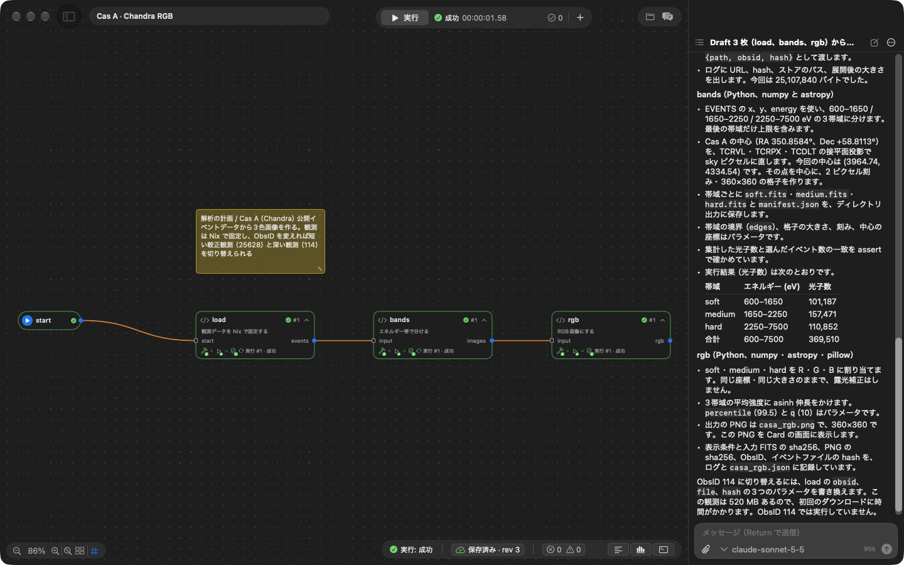
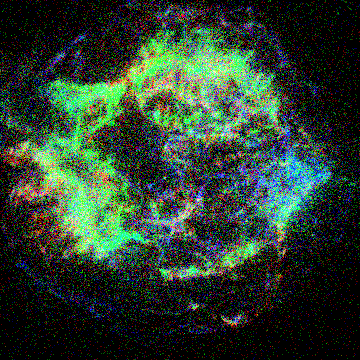

# 実際の Claude API での実行記録

Draft だけのプロジェクトから、アプリ内の Agent に「Card を生成」させ、実際に実行して結果を確かめるまでを、実際の Claude API で通した記録です。
自動テストはテスト用のモデル（`tests/fixtures/model_fixture.py`、決まった規則で答える HTTP サーバー）を使うので、本物のモデルの判断はこの記録で確かめています。

- 日時: 2026-11-04
- モデル: `claude-sonnet-5-5`（Anthropic Messages API、プロンプトキャッシュあり）
- 実行環境: 共通 VM（Apple silicon、macOS 27）
- 操作: UI スクリプト（`TSUGUMI_UI_SCRIPT`）で「Card を生成」を押し、終わるまで待つ。人の手は入れていません

## 題材：Cas A の 3 色画像

超新星残骸 Cas A の Chandra の観測から、エネルギー帯ごとの画像を作り、RGB に合成します。
プロジェクトは `start → load → bands → rgb` の 4 枚で、`load`・`bands`・`rgb` は研究者が意図だけを書いた Draft です。

| Draft | 研究者が書いた内容（要約） |
| --- | --- |
| load | 観測を Nix で固定して取得する。HEASARC のミラーから explicit FTPS で取り、hash で固定。ObsID・ファイル名・hash はパラメータ（ObsID 25628 と 114 の 2 つを列挙） |
| bands | 600–1650 / 1650–2250 / 2250–7500 eV の 3 帯域に分ける。Cas A の中心（RA 350.8584°, Dec +58.8113°）をファイルの座標から sky ピクセルに直し、そこを中心に 360×360 の格子で数える。光子数の一致を assert で確かめる |
| rgb | 3 帯域を R・G・B にして asinh で伸長した PNG を作り、表示する。表示条件と入力の hash を記録する |

## 結果



| 指標 | 値 |
| --- | --- |
| モデルの応答（ターン） | 20 |
| ツール呼び出し | 31（reference_read 14、project_save 3、run 3、run_status 3、run_record 3、log_range 3、project_inspect 1、project_validate 1） |
| ツールのエラー | 0 |
| 実行 | 3 回、すべて成功（1 回目は観測の取得を含めて 13 秒、2・3 回目は 2〜3 秒） |
| トークン | 入力 95,676、出力 13,495 |

Agent の進め方は、Agent への指示（Draft を上流から 1 枚ずつ、書く → 検証 → 保存 → 実行 → 結果を確かめる）のとおりでした。

1. `project_inspect` で現状を読み、`reference_read` で card-guide・Python SDK・同梱デモ（report の File/Directory 出力の Card）を読む（Agent が読める同梱デモは report・collatz・live-stream だけです。Draft のデモと、その完成形である casa などのデモは読めません。読めると答えを写せてしまい、この記録が検証になりません）
2. `load` を書き、`project_validate` で保存前に検証してから `project_save`、`run` で実行し `run_status`・`run_record`・`log_range` で確かめる
3. `bands`、`rgb` も同じ手順で 1 枚ずつ
4. 最後に何をどう実装したかを日本語で報告する

生成された `load` の `default.nix`（抜粋）。観測は Nix の fixed-output derivation として取得され、2 回目以降の実行はストアのファイルを使います。

```nix
raw = pkgs.fetchurl {
  inherit url;                      # ftp://heasarc.gsfc.nasa.gov/chandra/data/byobsid/8/25628/primary/...
  curlOptsList = [ "--ssl-reqd" ];  # explicit FTPS
  hash = params.hash;               # "nix": true の param
};
data = pkgs.runCommand "evt2-${id}.fits" { } "gunzip -c ${raw} > $out";
```

`bands` は Cas A の中心を sky ピクセル (3964.74, 4334.54) に直して数え、光子数は soft 101,187・medium 157,471・hard 110,852（計 369,510）でした。
`rgb` の出力（ObsID 25628、露光 2.1 ks）：



## 改善前の試行と、それを受けて直したこと

同じ題材を、データを Card の実行中に毎回ダウンロードする Draft（ObsID 114、523 MB）で試したときは、60 手の上限で止まりました。

| 指標 | 改善前 | 改善後（上の記録） |
| --- | --- | --- |
| ターン | 60（上限で中断） | 20（完了） |
| ツール呼び出し | 68（うち run_status 45） | 31（うち run_status 3） |
| 1 回の実行 | 483 秒（毎回 523 MB を取得） | 13 秒（初回）、2〜3 秒 |

原因と対処：

- `run_status` は 1 回に 30 秒しか待たず、8 分の実行を待つだけで手数を使い切っていた → 最大 5 分待つようにした（実行が終われば、その時点ですぐ返る）
- 大きな公開データを実行のたびに取得していた → Nix で固定してストアに置く書き方を card-guide に加えた（`"nix": true` の param、`fetchurl` と hash、ストアのパスを値として渡す）
- Agent が書いた Card の表示が、開き直すまでキャンバスに出なかった → 表示する Card の一覧を、差分を当てる前に取るように直した
