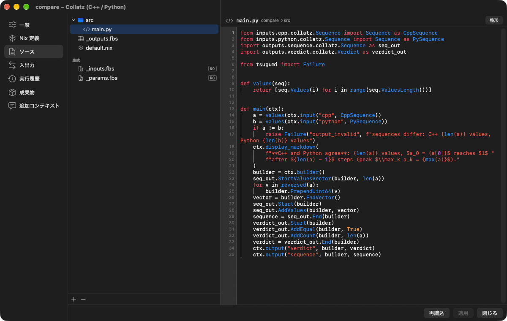

# Your first Card

Make a Card that just multiplies the number it receives, run it, and try other conditions.
After making it in Python, replace the same Card with C++, R and Julia.

This page is the Card specification. Each language's API (generated types, typed display values, dependency locks, threads) belongs to its SDK and is documented in [tsugumi-kit](https://github.com/gen740/tsugumi-kit/tree/main), the default SDKs. [Visualisation](Visualization.md), [marimo notebooks](Marimo.md) and [R reports](Reports.md) describe the demos built on those SDKs.

## What you will make

```text
start ──out→ settings ──number→ multiply
```

| Card | Kind | What it does |
| --- | --- | --- |
| `start` | Start (trigger) | Where the run begins |
| `settings` | Input value (input) | Sends a number you can edit on the Canvas |
| `multiply` | Python step | Multiplies the number it receives by `factor`, outputs the result and shows it in its view |

When it is done, the Canvas looks like this. Below are the same Cards as on the real screen, and they run without installing anything. Press ▶ Run to watch the flow, and click `multiply` to read the Python code on this page (web version only).

<div data-player="card-guide"></div>

## Making it on screen

1. Make a project with "New Project…" on the home screen.
2. Right-click the Canvas and, from "Add Card", place "Trigger", "Input Value" and "Draft", naming them `start`, `settings` and `multiply`.
3. Draw a wire from the output of `start` to `settings`, and from the output of `settings` to `multiply`.
4. Open each Card (the `s` key or "Settings" in the context menu) and apply the files in the next section. In the Draft’s settings, choose Code as the implementation kind.

A Card's settings look like this. Switch between "Source", "Ports" and "Nix Definition" in the list on the left to edit, and "Apply" puts the change into the Workflow.



A Card is ordinary files in the project folder, so writing them directly in an editor is the same. To start from Cards someone already wrote, copy a [template](#templates).

## The files

The whole project:

`tsugumi.json`

```json
{
  "name": "Your first Card",
  "pkgsPath": "tsugumi:default",
  "canvas": {
    "cards": [{"id": "start"}, {"id": "settings"}, {"id": "multiply"}],
    "connections": [
      {"from": {"card": "start", "port": "out"}, "to": {"card": "settings", "port": "start"}},
      {"from": {"card": "settings", "port": "number"}, "to": {"card": "multiply", "port": "number"}}
    ]
  }
}
```

`definitions/start/_card.json`

```json
{"type": "trigger"}
```

### The input value Card

Write the output type in `_outputs.fbs`. The fields of `Outputs` are the output ports.
`params` have the same names as the fields of the table that is output.

`definitions/settings/_card.json`

```json
{"type": "input", "params": [{"name": "value", "type": "uint64", "data": 21}]}
```

`definitions/settings/_outputs.fbs`

```text
namespace hello;
table Number { value:ulong; }
table Outputs { number:Number (required); }
root_type Outputs;
```

For a Path output, the `value` parameter names a saved project file or folder. A path such
as `data/events.fits` is relative to the input Card's own definition folder;
`project:definitions/shared/data/events.fits` explicitly uses the owning
project's root to name a saved source in another Card. Inside an
external project, these bases stay within that external project. Absolute paths
and `..` components are rejected. The file or folder is copied into the run before
it is passed downstream, so later source edits do not change that run's file.

### The processing Card (Python)

Write the names of the input ports in `inputs`. Input types are not written: they are derived from the outputs of the connected Cards.

`definitions/multiply/_card.json`

```json
{
  "type": "code",
  "inputs": [{"name": "number"}],
  "params": [{"name": "factor", "type": "uint64", "data": 2}]
}
```

`definitions/multiply/_outputs.fbs`

```text
namespace hello;
table Result { value:ulong; }
table Outputs { result:Result (required); }
root_type Outputs;
```

A Card's summary goes in `_meta.json`. It appears on the Canvas and in the Card's settings, so write briefly what the Card does.

`definitions/multiply/_meta.json`

```json
{
  "description": "Multiply number by factor"
}
```

The SDK, the environment and the Card's views go in `default.nix`. `inputs.tsugumi` holds the SDKs from tsugumi-kit, already bound to this Card's ports; `pythonSdk.pythonCard` builds the Card and `pythonSdk.views` are the views the Python SDK bundles. To use `numpy` and the like, add `packages = ps: [ ps.numpy ];` to `pythonCard`. Packages come from the project's pinned nixpkgs.

`definitions/multiply/default.nix`

```nix
{ pkgs, inputs, params }:
let
  sdk = inputs.tsugumi.pythonSdk;
in
{
  run = sdk.pythonCard { src = ./src; };
  views = builtins.filter (view: view.name == "text") sdk.views;
}
```

The body is a function from the Card's input to its output: `run(input) -> Output`. The SDK generates `card.py` with the `Input` and `Output` classes and one FlatBuffers object type per port, importable as `outputs.<port>.<namespace>.<table>`. `tsugumi.send` shows a value in the Card's view while it runs.

`definitions/multiply/src/main.py`

```python
import tsugumi
from card import Input, Output
from outputs.result.hello.Result import ResultT


def run(input: Input) -> Output:
    n = input.number.value
    factor = input.params.factor
    tsugumi.send(f"{n} × {factor} = {n * factor}")
    return Output(result=ResultT(value=n * factor))
```

The [Python SDK guide](https://github.com/gen740/tsugumi-kit/blob/main/sdk/python/README.md) lists the generated names, how strings and unions arrive and the typed values `tsugumi.send` accepts.

## Running it and checking

1. Press "Run" (⌘R) at the top of the Canvas. Only the first time takes a while, as Nix prepares the environment.
2. Open `multiply`'s view window: it shows `21 × 2 = 42` while the run goes on. The view is live: it is not saved with the run.
3. "Run History" in the context menu shows the time and logs of each stage (Nix evaluation, build, run, saving), and the `result` value of 42 that the run saved.

## Trying other conditions

- **Change only a parameter.** Set `factor` of `multiply` to 3 and run only `multiply` with "Run Only This Card (Last Inputs)" in the context menu. `settings` does not run, and with the saved input the result is `21 × 3 = 63`. `factor` is not passed to Nix, so nothing is rebuilt either.
- **Change something upstream.** After changing `value` of `settings`, run again from `start`. Partial runs use saved inputs, so an upstream change does not arrive until you run the whole ([Rerunning from the middle](Rationale.md#rerunning-from-the-middle)).
- **Go back to an earlier version.** Each run commits the changes to git. From "Version History…" (⌥⌘Y) in the Workflow menu, go back to an earlier version and start a different attempt ([Versions](Versions.md)).

## Inputs and outputs

A Card is `(input) -> output`. One call receives the values on its input ports and its parameters, and returns the values for its output ports. That is all that crosses between the Card and Tsugumi: there is no run ID, Card ID or invocation number, no hook before or after the call, and no report object. What the Card shows while it works goes to its [views](#views); what it writes to stdout and stderr goes to its log.

| SDK in `default.nix` | Entry point | Guide |
| --- | --- | --- |
| `cppSdk.cppCard` | `auto run(const Card::Inputs& input) -> Card::Output` | [C++](https://github.com/gen740/tsugumi-kit/blob/main/docs/cpp-sdk.md) |
| `pythonSdk.pythonCard` | `def run(input: Input) -> Output` | [Python](https://github.com/gen740/tsugumi-kit/blob/main/sdk/python/README.md) |
| `rSdk.rCard` | `main <- function(input)` returns a named list | [R](https://github.com/gen740/tsugumi-kit/blob/main/sdk/r/README.md) |
| `juliaSdk.juliaCard` | `main(input)` returns a NamedTuple or Dict | [Julia](https://github.com/gen740/tsugumi-kit/blob/main/sdk/julia/README.md) |
| `goSdk.goCard` | `func run(input tsugumi.Inputs) (tsugumi.Output, error)` | [Go](https://github.com/gen740/tsugumi-kit/blob/main/sdk/go/README.md) |
| `rustSdk.rustCard` | `fn run(input: Inputs<'_>) -> Result<Output, Failure>` with `tsugumi::export!(run)` | [Rust](https://github.com/gen740/tsugumi-kit/blob/main/sdk/rust/README.md) |
| `rubySdk.rubyCard` | `def main(input)` returns a Hash | [Ruby](https://github.com/gen740/tsugumi-kit/blob/main/sdk/ruby/README.md) |
| `csharpSdk.csharpCard` | `public static Output Run(Input input)` | [C#](https://github.com/gen740/tsugumi-kit/blob/main/sdk/csharp/README.md) |

Any SDK that implements the [Card ABI](CardABI.md) can take the place of these: the core knows no language, only a built `lib/main.so` that exports `tsugumi_main`.

The SDK generates the Card's types from `_inputs.fbs` (the connected outputs), `_outputs.fbs` (the Card's output schema), and `_params.fbs` (its parameters). Read the generated source (for example `card.hh` or `card.py` in the build result) to see the exact names.

- An input declaration contains its name. Connect one wire to give it the upstream output’s type. An unconnected input is absent. The Card’s SDK reports `input_missing` with the port name when the Card requires an absent input.
- Parameters are one `parameters.Params` message. A scalar parameter without a value is absent rather than zero.
- The Card returns one value per output port it produces. A missing required output fails the call with `output_invalid`. The SDK checks the payload against the port's type.
- Numeric messages keep IEEE NaN, positive and negative infinity and signed zero.

### Building outputs

A Path port carries the path directly.

- **A new file or directory.** Create it under the Card's working directory, finish writing and close it **before returning**, then return its path. A relative path such as `filtered.csv` works. Directories may contain regular files and subdirectories. The worker rejects symlinks, paths under `TMPDIR` and granted host paths as new outputs.
- **Forwarding an input**: return the input's path unchanged. Tsugumi records the stored original without copying it.

The worker snapshots the new files after the call returns. Each call has limits on the total bytes and number of entries it outputs, set in the project's settings (64 GiB and 1,000 entries by default; forwarded inputs do not count). Exceeding them fails the call with `output_invalid`. [Run history](RunHistory.md#keep-and-open-artifacts) describes how outputs are kept.

### Failures and cancellation

Raise or return the SDK's failure (Python `tsugumi.Failure("validation_failed", "why")`, C++ `tsugumi::Failure(kind, message)` and so on) to fail the call with a kind, a message and, where the SDK can tell, the source file and line. Any other uncaught error fails with `worker_failed`. A failed call's outputs are discarded and its worker is not reused.

During a call, the Card can ask whether it has been cancelled and how much of its deadline remains (`cancelled()` and `remaining_ms()` in each SDK). A long loop should check between units of work. A stop or deadline also ends code that does not check.

## Writing the same Card in another language

As long as the input and output types are the same, what is inside can be replaced while the wires on the Canvas and the Cards around it stay as they are. `_card.json` and `_outputs.fbs` stay the same as for Python. Only `default.nix` and `src/` change.

### C++

The input and output ports become members of `Card::Inputs` and `Card::Output`.

`definitions/multiply/default.nix` (C++)

```nix
{ pkgs, inputs, params }:
let
  sdk = inputs.tsugumi.cppSdk;
in
{
  run = sdk.cppCard { src = ./src; };
  views = builtins.filter (view: view.name == "text") sdk.views;
}
```

`definitions/multiply/src/card.cc` (C++)

```cpp
#include "card.hh"

#include <string>

auto run(const Card::Inputs& input) -> Card::Output {
  const auto n = input.number.value;
  const auto factor = input.params.factor.value_or(1);
  card::display::send(std::to_string(n) + " × " + std::to_string(factor) +
                      " = " + std::to_string(n * factor));
  Card::Output output;
  output.result.emplace().value = n * factor;
  return output;
}
```

### R

Messages are named lists. Packages come from nixpkgs' `rPackages` (`packages = ps: [ ps.survival ps.ggplot2 ];`). The R SDK bundles no views, so the Card takes the `text` view from the C++ SDK.

`definitions/multiply/default.nix` (R)

```nix
{ pkgs, inputs, params }:
{
  run = inputs.tsugumi.rSdk.rCard { src = ./src; };
  views = builtins.filter (view: view.name == "text") inputs.tsugumi.cppSdk.views;
}
```

`definitions/multiply/src/main.R` (R)

```r
main <- function(input) {
  n <- input$number$value
  factor <- input$params$factor
  send(sprintf("%g × %g = %g", n, factor, n * factor))
  list(result = list(value = n * factor))
}
```

R keeps integers exactly only up to 2^53: larger ones arrive as decimal strings, and a decimal string is also how to return one. `stop("why")` fails the call with its message.

### Julia

Messages are dictionaries keyed by field name.

`definitions/multiply/default.nix` (Julia)

```nix
{ pkgs, inputs, params }:
{
  run = inputs.tsugumi.juliaSdk.juliaCard { src = ./src; };
  views = builtins.filter (view: view.name == "text") inputs.tsugumi.cppSdk.views;
}
```

`definitions/multiply/src/main.jl` (Julia)

```julia
function main(input)
    n = input.number["value"]
    factor = input.params["factor"]
    send("$n × $factor = $(n * factor)")
    return (; result=(; value=n * factor))
end
```

### Go, Rust, Ruby and C#

The same Card in these languages has the same `_card.json` and `_outputs.fbs`, a `default.nix` that names `goSdk.goCard`, `rustSdk.rustCard`, `rubySdk.rubyCard` or `csharpSdk.csharpCard`, and the entry point from the table above. Each SDK's guide in tsugumi-kit has a complete example. External modules, crates, gems and NuGet packages come from a lock and its hash named in `default.nix`; each SDK's guide says how to make them. Nothing is fetched while a Card runs.

## Views

A Card shows what it is doing in its views. A view is fixed by the Card's definition, before any run: the Card declares its views in `default.nix`, next to `run` and `exports`, and the Card's view window shows each of them, empty, until data arrives. While the Card runs it sends messages to a view by name; the view draws them.

```nix
{
  run = sdk.pythonCard { src = ./src; };
  views = sdk.views ++ [
    { name = "notes"; type = "html"; blob = ./notes.html; }
  ];
}
```

| Field | Meaning |
| --- | --- |
| `name` | The name the Card sends to |
| `type` | `"html"`: one self-contained HTML file. `"dawn"`: one Wasm binary drawn with WebGPU |
| `blob` | That one file, as a path or a derivation in the Nix store |

The SDK's own views are added explicitly with `sdk.views` (or a part of it, with `builtins.filter`); nothing is added for you. The C++ SDK bundles html views for text, Markdown, tables, images, line charts (`LineChart`, series of x/y) and points (`Points`, x/y/z with optional colours), and the Python SDK the same and Plotly. Each SDK's guide lists the views it bundles and the values it encodes for them. A Card written with an SDK that bundles none of the views it needs takes them from `inputs.tsugumi.cppSdk.views` or `inputs.tsugumi.pythonSdk.views`. A Card that never sends declares no views.

Where an SDK renders text into images (Matplotlib figures in the Python SDK, for example), it uses IPAexGothic from the kit as the Japanese fallback font, so Japanese labels render offline.

### Sending

The Card ABI gives the Card one effect, `send(view, bytes)`. The bytes are opaque to Tsugumi: their format is a private agreement between the code that sends and the view that reads. Each SDK has a raw form and typed forms that encode a value for one of its bundled views:

| Language | Raw bytes | A typed value |
| --- | --- | --- |
| C++ | `card::display::send("notes", bytes)` | `card::display::send(card::display::Table{columns, rows})` |
| Python | `tsugumi.send("notes", data)` | `tsugumi.send(tsugumi.Markdown("**42**"))`, `tsugumi.send(tsugumi.mpl.figure(fig))` |
| R, Julia | `send("notes", bytes)` | `send(value)` |
| Go | `tsugumi.Send("notes", data)` | `tsugumi.SendValue(value)` |
| Rust | `tsugumi::send("notes", data)` | `tsugumi::send_value(value)` |
| Ruby | `Tsugumi.send("notes", data)` | `Tsugumi.send(value)` |
| C# | `Effects.Send("notes", data)` | `Effects.Send(value)` |

- The core passes the message through without looking at it: it adds the Card and the run that is active when the message arrives and hands it to the UI. It does not check the view name. The UI matches the name against the Card's declared views and shows an error for a name the Card did not declare.
- `send` stays valid for the life of the Card's process. A thread the Card started can keep sending after the call returns, for example to show progress of work that continues between calls.
- When the UI falls behind, it keeps only the latest message for each view. Views also hear when a run that includes the Card starts and ends.
- **Nothing a Card sends is recorded.** A view is for watching the work as it happens; it is not saved with the run, and it cannot be reopened from Run History, compared between runs or read by the Agent afterwards. A value people should check later belongs in an output port, a file or an artifact.

### HTML views

An `html` view is one self-contained HTML file: scripts, styles, fonts, images and any Wasm are inlined. The UI loads it in an isolated frame with no network access (`connect-src 'none'`), so nothing can be fetched at run time.

The page draws its own empty state when it loads. The UI then posts one window message, `{tsugumi: 1, port}`, transferring a `MessagePort`. Everything else arrives on that port:

| Message | Meaning |
| --- | --- |
| `{type: "data", bytes: ArrayBuffer}` | One message the Card sent to this view |
| `{type: "run", state: "started"}` / `{type: "run", state: "ended"}` | A run that includes this Card started or ended |

```html
<!doctype html>
<meta charset="utf-8">
<main>No data yet</main>
<script>
  const main = document.querySelector('main')
  window.addEventListener('message', event => {
    if (event.data?.tsugumi !== 1) return
    event.data.port.onmessage = ({ data }) => {
      if (data.type === 'data') main.textContent = new TextDecoder().decode(data.bytes)
      if (data.type === 'run') main.dataset.run = data.state
    }
  })
</script>
```

The view owns its layout and resizing. To bundle libraries into one file, build the HTML with Nix (the kit's [bundled views](https://github.com/gen740/tsugumi-kit/tree/main/sdk/views) use esbuild in a `runCommand`) and give the derivation as `blob`. [Showing Card views](security.md#showing-card-views) describes their isolation.

### Dawn views

A `dawn` view is a Wasm binary that draws with WebGPU through the pinned `webgpu.h` and nothing else. The UI does not host it yet: a declared `dawn` view shows a placeholder. Its exports are being fixed in the [Card ABI](CardABI.md).

## Worker state

Cards start a fresh worker for each call by default. Set `reuseWorker: true` to keep one worker for the Card: memory, loaded libraries and files in its working directory survive across calls and runs. One worker takes one call at a time. There is no hook at the start of a run, so a Card that keeps state decides from its inputs when to reset it, for example starting over when a loop's initial value arrives. Resident workers have no count, idle-time or memory eviction limit, including workers used for monitoring. They live until the project's environment stops or the Card's definition, SDK, grants or a secret value changes; a call already running when the definition changes finishes on the old version. A failed, cancelled or timed-out call always discards its worker; the next call starts fresh and logs the reason, as it does after a crash. Each invocation records whether its worker already held state (`worker_reused`). Ordinary fresh workers prepared for speed remain limited to 32, ten minutes idle and 2 GiB each.

| Location | Use | Lifetime |
| --- | --- | --- |
| Working directory, also `HOME` | The Card's files and caches. New outputs are created here. | The worker. A reused worker keeps the contents. |
| `TMPDIR` | Scratch. Read the path from the environment. | Cleared for each call. |
| `/tmp` | On Linux workers, the shared VM and remote workers, the same scratch as `TMPDIR`. | On native macOS only `TMPDIR` is scratch. |

The worker sets the working directory, `HOME`, `TMPDIR` and the environment at launch. A file input's path is valid only during its call. A cache in `HOME` should be safe to rebuild when a later call finds it missing. The Card's process gets no shell and no `PATH` of its own: there is no implicit `/bin/sh`. A Card that runs other programs declares them to its SDK's builder, for example `sdk.pythonCard { src = ./src; tools = [ pkgs.coreutils pkgs.ripgrep ]; }`, and the builder puts exactly those on the Card's `PATH`. Packages come from the project's pinned nixpkgs.

## Card definition reference

### A Card's folder

`definitions/<id>/` belongs to one Card. Its identifier is permanent; its editable human name is `_meta.json.name`, with the identifier shown when the name is omitted. Names may be shared by several Cards. New identifiers come from the core `card_id` RPC: the lowercase slug of the creation name, then `-2`, `-3`, and so on when that name is occupied, checked for uniqueness in the owning project (including reserved unsaved Cards and case variants). Pass `project_path` for a Card in Card, then save the definition and canvas using the returned identifier. The slug uses lowercase ASCII letters and digits separated by hyphens; a name without those characters uses `card`. Identifiers already present, including unsuffixed ones, stay as written.

Renaming changes only `_meta.json.name`. Definition folders, canvas keys, connections, saved inputs, run records and evidence links retain their identifiers. The same rule holds inside a Card in Card.

Definition files:

| File | What it is |
| --- | --- |
| `_card.json` | What the Card is (`type`, required) and all settings: `inputs`, `params`, run settings |
| `_meta.json` | The human `name` and intent, for every kind of Card: `description` (its summary, shown on the Canvas and in Card settings; `_card.json` has none), `content`, `context`, port descriptions. When implementing a Draft, preserve its intent and fill an empty `description` and `context` from the user and Draft |
| `_outputs.fbs` | One table per output port, root table `Outputs` |
| `default.nix` | Code Cards only: a function `{ pkgs, inputs, params }:` returning `run` (one implementation or an ordered list), and optionally `views` and `exports`. Nothing else is accepted |
| `src/` | Code Cards only: the sources |

Never write `_inputs.fbs`: input types come from the connected outputs. The SDK is chosen in `default.nix`; `_card.json` has no language.

### Card types

Every `_card.json` states what the Card is in `type`; a missing or unknown `type` is a definition error.
`code` runs the Card's own sources (below), `draft` is a step described but not written yet, and `subgraph` is a Card in Card (with `external`).
The other types are built-in Cards with no code:

| Type | Ports | Use |
| --- | --- | --- |
| `trigger` | out `out` | Where a whole run starts |
| `input` | in `start`, outs from `_outputs.fbs` | Passes on values or a project file or folder |
| `branch` | ins `value`, `condition` (a [Condition buffer](CardABI.md#built-in-values)), outs `a` (true), `b` (false) | Sends to one side |
| `fork` | in `value`, outs as declared in `outputs` (default `a`, `b`) | Sends the same value to every output |
| `merge` | ins as declared in `inputs`, out `out` | Emits each arrival unchanged when every connected input has the same type. Mixed FlatBuffer inputs produce one union member per distinct type |
| `collect` | in `in`, out `out` | Sends a batch as one `Collected` buffer of opaque port envelopes |

Use one wire per input port. Route several paths into separate inputs of a Merge Card, then connect its output to the destination. Such a Card can print the value to stdout, which goes to its log, and send it to a `text` view.

### An input Card with fixed values

`demos/en/report/definitions/settings`: params named like the fields of its output table.
To control a Branch from the Canvas, declare a `bool` parameter named `value`
and an output message with a `value:bool` field. Wire that output to the
Branch’s `condition` input. The Canvas renders the parameter as a toggle.

```json
{"type": "input", "params": [{"name": "seed", "type": "uint64", "data": 42}]}
```

### An input Card that passes on a project file or folder

The editor has a picker for files and folders in the project. At run time the
worker stages a copy and the next Card receives its path.

`definitions/load/_card.json` (the path is relative to this Card's definition folder):

```json
{"type": "input",
 "params": [{"name": "value", "type": "string", "data": "data/events.fits"}]}
```

Use `project:definitions/shared/data/events.fits` for a saved source in another
Card of the owning project.
The same rules apply inside external projects: `project:` names that external
project's root. Paths cannot be absolute or contain `..`, and must name a saved
project file or a folder containing saved sources. The base never changes according to which file exists.

`_outputs.fbs` (a Path port):

```
attribute "tsugumi";
table Outputs { events:string (required, tsugumi: "path"); }
root_type Outputs;
```

The next Card reads the path directly, for example `Path(input.events)` in Python.

### Code Card settings

A Code Card has `"type": "code"`. Choose the SDK in the Card’s `default.nix`. Declare input port names in `inputs`; connected outputs determine their types. Parameters are entries such as `{"name": "low", "type": "double", "data": 600}`. Their types are `bool`, `int64`, `uint64`, `double`, `string` and arrays of those types; they arrive in the Card's input as `params`. A parameter with `nix: true` is also a build-time value in `default.nix`, as `params.<name>`; changing it rebuilds the Card.

Network access is off by default where the worker can isolate it. Set `grants.network` to true to allow it. TLS uses the Nix `cacert` bundle through `SSL_CERT_FILE`; report downloaded data's URL, size and SHA-256. For immutable public data, prefer a pinned Nix fetch as described below.

Use `executionService` to select a registered service. The default is `auto`. In `sandbox`, `filesystem`, `pid`, `ipc` and `identity` default to true. Use `sandbox.limits.cpu` for a limit in cores (fractions are allowed) and `sandbox.limits.memoryMiB` for a memory limit in MiB. Omit either value or use `null` for an unlimited resource. A Linux worker with delegated cgroup v2 applies these limits to the Card's process.

Set `grants.network` or `grants.gui` to enable that access on a supported worker. Add named paths with `grants.hostPaths` entries containing `name`, an absolute `path` and an optional `write` flag. The Card reads the worker-visible path from `TSUGUMI_GRANT_<NAME>`, using uppercase letters and underscores in place of other separators. For example, `sample-data` becomes `TSUGUMI_GRANT_SAMPLE_DATA`.

Connection details and credentials belong to the host; see [Remote execution](RemoteExecution.md). Worker state follows the [worker state rules](#worker-state).

### Card secrets

A Card that needs a credential declares only its names: `"secrets": ["database_password"]`. A name is `[a-z][a-z0-9_]{0,63}`. Set the value in the project's **Settings > Card secrets** in the Mac app or the Web UI; this host's hostd keeps it for that project only and never shows it again. At launch the Card's process receives it as an environment variable of the same name, the same way in every language:

```python
import os
password = os.environ["database_password"]
```

The value is not in the project, its parameters, its Nix build or the run history; the history records only that `database_password` was provided. A Card whose secret is not set fails before it runs and names the missing one. When a secret changes, the next run starts a fresh worker. A [remote worker](RemoteExecution.md#card-secrets) receives secrets at launch too.

What the Card does with the value is its author's responsibility: child processes inherit the environment, and a value the Card prints, logs or writes to an output is recorded like any other. Pass it on only where it is needed (to a subprocess, in its environment rather than its command line), and never send it to a view or write it to an output. See [Card secrets](security.md#card-secrets).

### Run lists and connected Nix exports

Use `demos/en/signal-sweep` for a parameter sweep. The `samples` Input Card
sweeps its `value` parameter: `"sweep": [8, 12, 16]` in place of `"data"` hands
on each signal in its own invocation, labeled `value=8` and so on.

A Code Card compares implementations with a run list: `run` is a list of
`{ label; run; }`, one built Card per entry. The label names the implementation
in the history and when comparing runs. Labels are unique within a list. The
`score` Card receives `samples.out` on its `signal` port and builds one
implementation per threshold from the same source, with the threshold written
beside `main.py` as `threshold.py`:

```nix
{ pkgs, inputs, params }:
let
  sdk = inputs.tsugumi.pythonSdk;
  thresholds = [
    10
    14
  ];
  compare = threshold: {
    label = "threshold=${toString threshold}";
    run = sdk.pythonCard {
      src = pkgs.runCommand "score-threshold-${toString threshold}" { } ''
        cp -r ${./src} $out
        chmod -R +w $out
        echo "THRESHOLD = ${toString threshold}" > $out/threshold.py
      '';
    };
  };
in
{
  run = map compare thresholds;
  exports.thresholdCount = builtins.length thresholds;
}
```

A list-typed parameter (`"type": "uint64[]"`) with `data` is one ordinary
vector value. Only `sweep` makes a batch, also for a single value
(`"sweep": [5]` is ×1); each element of a list-typed sweep is one vector.
Several swept parameters run their Cartesian product, the last one varying
fastest. Code Cards use run lists instead of `sweep`.

The three swept values and two implementations produce six invocations, in input
item order with implementation order varying fastest. Every batch input is an
independent axis. `maxRuns` counts triggers, and a failed member cancels the
rest of the batch. Inspect each member's history for its inputs and result.
An empty list yields an empty batch.

Add a built-in `collect` after `score` to send one ordinary port value with an
`items` vector, which the `summary` Card reads on its `results` port
(`input.results.items`). Each item carries its name and kind, with the original
bytes or path. See the fixed [Collected layout](CardABI.md#built-in-values).

Refer to Nix exports as `inputs.<destination-port>`. Collect, Fork, Branch's
`value` input and Workflow boundaries preserve a unique Code producer. Use a
direct connection to that Code Card if the producer would otherwise be
ambiguous. The `score` Card exports `thresholdCount`, which `summary` reads through
Collect as `inputs.results.thresholdCount` and writes beside its own source the
same way. Each run implementation shares the same exports.

### Data fixed by Nix

Large public data (an observation, a reference genome, a simulation's result) can be fixed like a
package: fetched once into the Nix store by its hash, never during a run. A param with `"nix":
true` is readable in `default.nix` as `params.<name>` (changing it rebuilds the Card). The store
path reaches the Card's code through a small generated module beside its source:

```nix
{ pkgs, inputs, params }:
let
  raw = pkgs.fetchurl {
    url = "ftp://host/path/${params.file}";  # explicit FTPS: ftp:// with
    curlOptsList = [ "--ssl-reqd" ];           # --ssl-reqd (often faster than https)
    hash = params.hash;                        # "sha256-..." (nix hash file <file>)
  };
  data = pkgs.runCommand "data.fits" { } "gunzip -c ${raw} > $out";
in
{
  run = inputs.tsugumi.pythonSdk.pythonCard {
    src = pkgs.runCommand "load-src" { } ''
      cp -r ${./src} $out
      chmod -R +w $out
      echo 'EVENTS = "${data}"' > $out/observation.py
    '';
  };
}
```

The Card returns the store location as data in a FlatBuffer table such as
`{ path:string; }`. A long build step (a simulation) can use the same approach
with `pkgs.runCommand` or `stdenv.mkDerivation`.

### Path outputs

Declare the output as `string (tsugumi: "path")` and create the file or directory
under the Card's working directory before returning its path. See [Building outputs](#building-outputs).

### Reading a merge output

The input is a table whose `value` is a union with one member per merge input; the union's type
says which port the value arrived on. In the SDKs that use FlatBuffers' object API (C++, Python,
Go, Rust, C#), read the generated union type and value fields; R, Julia and Ruby give
`{type = "port", value = ...}`. Each SDK's guide shows the generated names.

### Templates

A template is a folder of Card definition directories: one Card, several Cards, or part of a graph
with its internal connections and an optional `layout.json` fragment. Choose **From Template…** in
**New Card** to copy one into the graph. The copy gets fresh Card IDs; connect its boundary ports to
the rest of the project.

| Store | Where | Scope |
| --- | --- | --- |
| **Project** | The project's `templates/` folder | Versioned with the project |
| **Host** | `templates/` in this host's Tsugumi support folder | Shared by the projects on this host |

The menu lists both stores separately, with nothing preselected; the same name in both stores
appears twice with its store label. Add a template to either store from a folder or from a public
HTTPS Git repository with a ref (a commit ID selects an exact version) and the template's
subdirectory. The examples in [tsugumi-kit's templates](https://github.com/gen740/tsugumi-kit/tree/main/templates)
import with the repository `https://github.com/gen740/tsugumi-kit.git` and a subdirectory such as
`templates/filter-counts`. Tsugumi lists, imports and copies templates; a person or the Agent
chooses one, and there is no default per language. The Agent may list and copy templates; adding
or importing one needs a person's approval. The [template format](https://github.com/gen740/tsugumi-kit/blob/main/docs/templates.md)
is described in the kit.

### Draft wire ends and implementation

A Draft (`_card.json` with `"type": "draft"`) has no input or output ports,
including when `_meta.json` contains port descriptions or `_outputs.fbs` exists.
A connection attaches directly to the Draft with `{"card":"plan","port":""}`.
The `port` field is required; the empty string is reserved for Draft ends.
Any number of wires can enter or leave a Draft, including wires between Drafts.
A real Card's endpoint still names an existing input or output. The other end's
port name and the Draft's content explain the planned connection.

Draft ends carry the Empty type, do not constrain type checking, and never
prevent saving because of their type. Drafts and Cards requiring their results
do not run; independent implemented paths run as before.

When implementing a Draft, explicitly rebind **every** incoming wire to a real
input and every outgoing wire to a real output in the **same save** as the new
definition. Include `SetProject` in `project_save`; inside a Card in Card, update
its project's `tsugumi.json` and any boundary endpoints too. Ends on other Drafts
stay empty. A single possible port is still an explicit choice. A save leaving
a wire on a non-existent port of a real Card fails with `validation_failed`
and names the wire. No endpoint is inferred or migrated.

In Mac and Web Card settings, choose **Implement Draft by hand** under General,
edit the definition's inputs, sources and output schema, and fill **Rebind wires**
under Ports before Apply. Each wire starts with an empty choice. Apply saves the
implementation and the selected endpoints together; a rejection leaves the
working copy open for correction.

## What to read next

| To know | Document |
| --- | --- |
| Branches, merges and loops, passing files, data pinned with Nix | [The bundled demos](Demos.md) (their code is still to be ported to Card ABI 9: [TODO](Demos.md#todo-port-the-demos-to-card-abi-9)) |
| Examples of code that runs | [tsugumi-kit's templates](https://github.com/gen740/tsugumi-kit/tree/main/templates) |
| One language's API, dependencies and threads | [tsugumi-kit](https://github.com/gen740/tsugumi-kit/tree/main) |
| The contract between the core and an SDK | [Card ABI](CardABI.md) |
| Leaving implementation to the Agent | [the Agent in Features](features.md#9-agent) |
| What the words mean | [Glossary](Glossary.md) |
