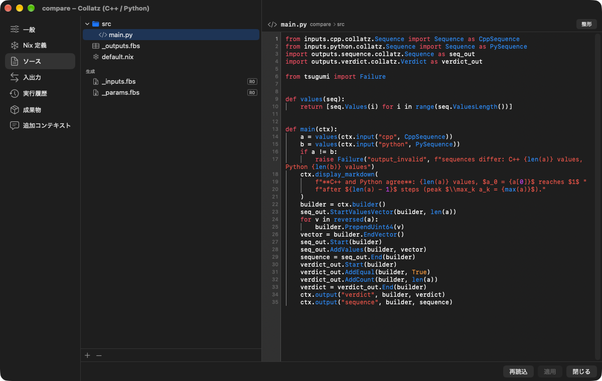

# Your first Card

Make a Card that just multiplies the number it receives, run it, and try other conditions.
After making it in Python, replace the same Card with bash, C++, R and Julia.

The full specification is in [agent/Reference/card-guide.md](../agent/Reference/card-guide.md), the same document the app's Agent reads.

## What you will make

```text
start ──out→ settings ──number→ multiply
```

| Card | Kind | What it does |
| --- | --- | --- |
| `start` | Start (trigger) | Where the run begins |
| `settings` | Input value (input) | Sends a number you can edit on the Canvas |
| `multiply` | Processing (Python) | Multiplies the number it receives by `factor`, outputs the result and displays it |

When it is done, the Canvas looks like this. Below are the same Cards as on the real screen, and they run without installing anything. Press ▶ Run to watch the flow, and click `multiply` to read the Python code on this page (web version only).

<div data-player="card-guide"></div>

## Making it on screen

1. Make a project with "New Project…" on the home screen.
2. Right-click the Canvas and, from "Add Card", place "Start", "Input value" and "Processing (Python)", naming them `start`, `settings` and `multiply`.
3. Draw a wire from the output of `start` to `settings`, and from the output of `settings` to `multiply`.
4. Open each Card (the `s` key or "Settings" in the context menu) and make it the same as the files in the next section.

A Card's settings look like this. Switch between "Source", "Ports" and "Nix Definition" in the list on the left to edit, and "Apply" puts the change into the Workflow.



A Card is ordinary files in the project folder, so writing them directly in an editor is the same.

## The files

The whole project:

`tsugumi.json`

```json
{
  "name": "Your first Card",
  "pkgsPath": "tsugumi:default",
  "canvas": {
    "cards": [{"id": "start"}, {"id": "settings"}, {"id": "multiply"}],
    "connections": [
      {"from": {"card": "start", "port": "out"}, "to": {"card": "settings", "port": "start"}},
      {"from": {"card": "settings", "port": "number"}, "to": {"card": "multiply", "port": "number"}}
    ]
  }
}
```

`definitions/start/_card.json`

```json
{"template": "trigger"}
```

### The input value Card

Write the output type in `_outputs.fbs`. The fields of `Outputs` are the output ports.
`params` have the same names as the fields of the table that is output.

`definitions/settings/_card.json`

```json
{"template": "input", "params": [{"name": "value", "type": "uint64", "data": 21}]}
```

`definitions/settings/_outputs.fbs`

```text
namespace hello;
table Number { value:ulong; }
table Outputs { number:Number (required); }
root_type Outputs;
```

For a File output, the `value` parameter names a saved project source. A path such
as `data/events.fits` is relative to the input Card's own definition folder;
`project:definitions/shared/data/events.fits` explicitly uses the owning
project's root to name a saved source in another Card. Inside an
external project, these bases stay within that external project. Absolute paths
and `..` components are rejected. The file is copied into the saved run before
it is passed downstream, so later source edits do not change that run's file.

### The processing Card (Python)

Write the names of the input ports in `inputs`. Input types are not written: they are derived from the outputs of the connected Cards.

`definitions/multiply/_card.json`

```json
{
  "language": "python",
  "inputs": [{"name": "number"}],
  "params": [{"name": "factor", "type": "uint64", "data": 2}]
}
```

`definitions/multiply/_outputs.fbs`

```text
namespace hello;
table Result { value:ulong; }
table Outputs { result:Result (required); }
root_type Outputs;
```

A Card's summary goes in `_meta.json`. It appears on the Canvas and in the Card's settings, so write briefly what the Card does.

`definitions/multiply/_meta.json`

```json
{
  "description": "Multiply number by factor"
}
```

The environment goes in `default.nix`. To use `numpy` and the like, add `packages = ps: [ ps.numpy ];` to `pythonCard`.

A package that nixpkgs does not have, or a version it does not carry, comes from PyPI through a lock that belongs to the Card. Nothing is resolved when a Card is built: a Card uses PyPI packages only when its `default.nix` names both the lock and the hash of what the lock fetches.

1. Put a `pyproject.toml` in the Card's folder, beside `default.nix`:

   ```toml
   [project]
   name = "card"
   version = "0"
   requires-python = ">=3.11"
   dependencies = ["tabulate==0.9.0"]
   ```

2. Make `uv.lock` beside it. In the project's terminal (the lock is made by uv, which needs the network once):

   ```sh
   cd definitions/multiply
   nix shell nixpkgs#uv nixpkgs#python3 --command env UV_PYTHON_DOWNLOADS=never uv lock
   ```

3. Name the lock in `default.nix`, with a placeholder hash:

   ```nix
   run = inputs.tsugumi.pythonCard {
     inherit sdk;
     src = ./src;
     lock = ./uv.lock;
     hash = pkgs.lib.fakeHash;
   };
   ```

4. Run the Card once. The Card’s build log reports `hash mismatch ... got: sha256-...`. Replace `pkgs.lib.fakeHash` with that hash (`hash = "sha256-...";`) and run again.

From then on the Card is built from exactly those files, without the network. To change a dependency, edit `pyproject.toml`, repeat steps 2 to 4, and keep `pyproject.toml`, `uv.lock` and `default.nix` together in the Card's folder. A lock that no longer matches `pyproject.toml`, a lock without a hash and a hash that does not match are errors that say so; an old hash never lets the previous packages through.

- Only wheels are installed. A package that has no wheel for the Card's Python and system fails with a message; take such a package from nixpkgs with `packages`. `packages` and `lock` can be used together, and a locked package wins over one of the same name from nixpkgs.
- Compiled wheels differ per system, so their hash does too. Give one per system the Card is built for: `hash = { aarch64-linux = "sha256-..."; x86_64-linux = "sha256-..."; };`.
- A compiled wheel that loads a shared library beyond the C and C++ runtimes and zlib gets it from `libraries = [ pkgs.libGL ];`.

`definitions/multiply/default.nix`

```nix
{ pkgs, inputs, params }:
let
  sdk = inputs.tsugumi.sdk { languages = [ "python" ]; };
in
{
  run = inputs.tsugumi.pythonCard { inherit sdk; src = ./src; };
}
```

The body is `main(ctx)`. Import inputs from `inputs.<port>.<namespace>.<table>` and outputs from `outputs.<port>.<namespace>.<table>`.

`definitions/multiply/src/main.py`

```python
from inputs.number.hello.Number import Number
import outputs.result.hello.Result as result_out

def main(ctx):
    n = ctx.input("number", Number).Value()
    factor = ctx.params().Factor()
    b = ctx.builder()
    result_out.Start(b)
    result_out.AddValue(b, n * factor)
    ctx.output("result", b, result_out.End(b))
    ctx.display_text(f"{n} × {factor} = {n * factor}")
```

## Running it and checking

1. Press "Run" (⌘R) at the top of the Canvas. Only the first time takes a while, as Nix prepares the environment.
2. `multiply` displays `21 × 2 = 42`.
3. "Run History" in the context menu shows the time and logs of each stage (Nix evaluation, build, run, saving).

## Trying other conditions

- **Change only a parameter.** Set `factor` of `multiply` to 3 and run only `multiply` with "Run Only This Card (Last Inputs)" in the context menu. `settings` does not run, and with the saved input the result is `21 × 3 = 63`. `factor` is not passed to Nix, so nothing is rebuilt either.
- **Change something upstream.** After changing `value` of `settings`, run again from `start`. Partial runs use saved inputs, so an upstream change does not arrive until you run the whole ([Rerunning from the middle](Rationale.md#rerunning-from-the-middle)).
- **Go back to an earlier version.** Each run commits the changes to git. From "Version History…" (⌥⌘Y) in the Workflow menu, go back to an earlier version and start a different attempt ([Versions](Versions.md)).

## Writing the same Card in another language

As long as the input and output types are the same, what is inside can be replaced while the wires on the Canvas and the Cards around it stay as they are.

### Python, with plain objects

The generated Python classes also come in an object form (`NumberT`, `ResultT`, `ParamsT`): plain attributes named after the schema's fields (`photon_count` becomes `photonCount`), and `Pack` to build an output. `tsugumi.contract` gives an input or the params in that form without importing the class by name, and lists the Card's ports (`contract.ports()`, `contract.port("number")["kind"]`). It is meant for code shared by many Cards, which cannot know the port types when it is written.

`definitions/multiply/src/main.py` (Python objects)

```python
from outputs.result.hello.Result import ResultT
from tsugumi import contract

def main(ctx):
    n = contract.input_object(ctx, "number").value
    factor = contract.params_object(ctx).factor
    result = ResultT()
    result.value = n * factor
    b = ctx.builder()
    ctx.output("result", b, result.Pack(b))
    ctx.display_text(f"{n} × {factor} = {n * factor}")
```

### bash

Delete `src/`, set `language` to `bash`, and write a string in `run` of `default.nix`. Inputs are `$JSON_<PORT>` (the path of a JSON file); write the output as JSON to `$TSUGUMI_OUTPUT`.

`definitions/multiply/_card.json` (bash)

```json
{
  "language": "bash",
  "inputs": [{"name": "number"}],
  "params": [{"name": "factor", "type": "uint64", "data": 2, "nix": true}]
}
```

`definitions/multiply/default.nix` (bash)

```nix
{ pkgs, inputs, params }: {
  run = ''
    jq --argjson f ${toString params.factor} '{result: {value: (.value * $f)}}' "$JSON_NUMBER" > "$TSUGUMI_OUTPUT"
  '';
}
```

Here `"nix": true` is set and `factor` is read from the Nix expression. This param is passed to Nix, so changing it rebuilds the Card. To read params at run time instead, all of them are in `$TSUGUMI_PARAMS_JSON` (the JSON text).

For a display, write JSON to `$TSUGUMI_DISPLAY`: one of `{"markdown": "**bold**"}`, `text`, `table` (`columns` and `rows`), `image` (`path` and `alt`) or `module` (`module`, `config`, and optional `blobs`, a map of names to local file paths). It is shown when the script ends normally.

To log and show a value of any connected type, see the ordinary Bash Card in
[`demos/en/marimo/definitions/result`](../demos/en/marimo/definitions/result).
It declares a required `in` port and lets the connection supply its type.
In `text` mode, the worker's formatted value goes to stdout and to the
Canvas as text. The format can include `nan` and `inf`, so it is meant for
inspection and does not promise strict JSON. Byte vectors appear as arrays of
numbers. File and Directory messages show their staged paths.

Set `format` to `markdown` to render a string field (named `value` by default).
Set `markdown_field` to select another top-level field. This mode reads the
input as an object and fails if the selected field is missing or is not a
string. The full formatted message still goes to stdout. Canvas displays
larger than 1 MiB are shortened with a marker, independently of the normal
worker and log limits. Each run logs and displays the value again, even when
the Card's build is reused.

### C++

The input and output ports become members of `Card::Input` and `Card::Output` as they are.

`definitions/multiply/_card.json` (C++)

```json
{
  "language": "cpp",
  "inputs": [{"name": "number"}],
  "params": [{"name": "factor", "type": "uint64", "data": 2}]
}
```

`definitions/multiply/default.nix` (C++)

```nix
{ pkgs, inputs, params }:
let
  sdk = inputs.tsugumi.sdk { languages = [ "cpp" ]; };
in
{
  run = inputs.tsugumi.cppCard { inherit sdk; src = ./src; };
}
```

`definitions/multiply/src/card.cc` (C++)

```cpp
#include <card.hh>

#include <string>

auto run(Card::Input& input) -> Card::Output {
  const auto n = input.number.value;
  const auto factor = Card::params().factor.value_or(1);
  Card::Output out;
  out.result.emplace().value = n * factor;
  tsugumi::visualization::text(std::to_string(n) + " × " + std::to_string(factor) + " = " + std::to_string(n * factor));
  return out;
}
```

### R

An R Card embeds R in the Card's worker. Messages are lists: the worker converts them in memory using the port’s FlatBuffers type, with no JSON files. Every invocation starts a new interpreter unless the Card turns `reuseWorker` on ([worker lifecycle](#r-and-julia-worker-lifecycle)).

`definitions/multiply/_card.json` (R)

```json
{
  "language": "r",
  "inputs": [{"name": "number"}],
  "params": [{"name": "factor", "type": "uint64", "data": 2}]
}
```

`definitions/multiply/default.nix` (R)

```nix
{ pkgs, inputs, params }: {
  run = inputs.tsugumi.rCard { src = ./src; };
}
```

`definitions/multiply/src/main.R` (R)

```r
main <- function(ctx) {
  n <- ctx$input("number")$value
  factor <- ctx$params$factor
  ctx$output("result", list(value = n * factor))
  ctx$display_text(sprintf("%d × %d = %d", n, factor, n * factor))
}
```

Packages come from nixpkgs' `rPackages` (`packages = ps: [ ps.survival ps.ggplot2 ];`). `ctx$plot(expr, alt = "description")` draws a figure in the Card's display (both base graphics and ggplot). Tables are `ctx$display_table(data.frame)`.

### Julia

A Julia Card embeds Julia in the Card's worker. Messages are Dicts, converted in memory using each port’s FlatBuffers type. Every invocation starts a new interpreter unless the Card turns `reuseWorker` on.

`definitions/multiply/_card.json` (Julia)

```json
{
  "language": "julia",
  "inputs": [{"name": "number"}],
  "params": [{"name": "factor", "type": "uint64", "data": 2}]
}
```

`definitions/multiply/default.nix` (Julia)

```nix
{ pkgs, inputs, params }: {
  run = inputs.tsugumi.juliaCard { src = ./src; };
}
```

`definitions/multiply/src/main.jl` (Julia)

```julia
function main(ctx)
    n = input(ctx, "number")["value"]
    factor = ctx.params["factor"]
    output(ctx, "result", Dict("value" => n * factor))
    display_text(ctx, "$n × $factor = $(n * factor)")
end
```

It runs with the standard library alone. The Nix helper retains `packages = [ "JuMP" ];`, but the pinned nixpkgs implementation uses import-from-derivation, which the Card evaluator disables; registry package resolution is currently rejected before the build. This limitation is independent of interpreter reuse. For a figure, pass a Vega-Lite spec as a Dict to `display_vegalite(ctx, spec)` and it is shown as an interactive chart.

### R and Julia worker lifecycle

**A Card keeps no state by default.** Every invocation gets a new worker and a new interpreter, which loads the source and then calls `main(ctx)`: nothing an earlier invocation or run did (globals, loaded packages, `options()`, the position of the random number generator) reaches the next one. Run it again by hand with the same inputs and it starts from the same place.

**To keep state, set `reuseWorker: true` in `_card.json`** ("Keep the worker's state" in the Card's settings). The Card then loads its source once and the same interpreter serves later invocations and runs. This is also what makes a Card that is called many times in a loop fast. What carries over from one call to the next:

- globals and module-level variables, and anything `library()` / `using` loaded or redefined;
- R's `options()`, `par()` and open graphics devices;
- the position of the random number generator (`.Random.seed`, Julia's default RNG): a second run continues the sequence where the first stopped unless the Card seeds it, in `main(ctx)` or in the hook below.

The working directory and environment variables do not carry over: the worker sets both again for every call. The optional `on_run_start(ctx)` hook runs once before the first invocation of each run; reset per-run state there. Each invocation's record says whether its worker had served an earlier call. The kept interpreter ends when the Card's source or packages change, after a failed, stopped or timed out call, and under the limits below; the next call then starts a new one.

Source loading happens before any invocation; read inputs and params inside `main(ctx)` or `on_run_start(ctx)`.

Every invocation receives a fresh context. Do not retain the context or use its functions from background threads: interpreter calls and host callbacks belong to the worker's main thread. `ctx$cancelled()` / `cancelled(ctx)` allow cooperative stopping; `ctx$remaining_ms()` / `remaining_ms(ctx)` return the remaining deadline in milliseconds, or `-1` without a deadline. A stop or expired deadline also terminates an uncooperative worker. Exceptions fail the invocation and appear in its log.

Displays publish immediately, including before a long calculation finishes. Each new display replaces the previous one. File and Directory inputs still use the worker's read-only paths, and outputs belong in the invocation's `output_directory`; those paths change on the next call. Nix continues to pin the interpreter and packages.

## The same Card in Ruby

Ruby uses MRI in the package worker. Inputs and parameters are Hashes and output is validated
against the FlatBuffers schema. The instance can retain state between invocations.

`definitions/multiply/_card.json` (Ruby)

```json
{"language":"ruby","inputs":[{"name":"number"}],"params":[{"name":"factor","type":"int64","data":2}]}
```

`definitions/multiply/default.nix` (Ruby)

```nix
{ pkgs, inputs, params }:
let sdk = inputs.tsugumi.sdk { languages = [ "ruby" ]; };
in { run = inputs.tsugumi.rubyCard { inherit sdk; src = ./src; }; }
```

`definitions/multiply/src/main.rb` (Ruby)

```ruby
def main(ctx)
  n = ctx.input('number').fetch('value')
  factor = ctx.params.fetch('factor')
  ctx.output('result', value: n * factor)
  ctx.display_text("#{n} × #{factor} = #{n * factor}")
end
```

For gems, keep a `Gemfile` and its `Gemfile.lock` together in the Card's directory. In the project terminal, run `bundle lock --add-platform ruby` from that directory. Add `lock = ./Gemfile.lock; hash = pkgs.lib.fakeHash;` to `rubyCard`. Run once and replace the placeholder with the fixed-output hash of the downloaded `.gem` files, reported as `got: sha256-…` in the Card's build log. The build then installs the locked gems offline. Native extensions can use libraries passed through `buildInputs`. When updating the Gemfile or lock, repeat the hash step.
Native gems are built by Nix; the worker never installs them at runtime. See the
[Ruby API](../agent/Reference/card-guide.md#ruby-srcmainrb) for files, displays and lifecycle details.

## Worker state

Cards start a fresh worker for each invocation by default. Set `reuseWorker: true` to retain state across invocations and runs; use the language's run-start hook to reset per-run state. Workers end when their build conditions change, on failure, cancellation or deadline, or when the project closes. Idle workers end after ten minutes; resident workers are limited to 2 GiB and 32 workers (least recently used ends first).

## What to read next

| To know | Document |
| --- | --- |
| Branches, merges and loops, passing files, data pinned with Nix | [The Card specification](../agent/Reference/card-guide.md), [The bundled demos](Demos.md) |
| Examples of code that runs | [demos/](../demos/) (`report`, `collatz` and others) |
| Leaving implementation to the Agent | [the Agent in Features](features.md#9-agent) |
| What the words mean | [Glossary](Glossary.md) |

## Go Cards

Start with the bundled `go-pipeline` demo. The [Go SDK and lock procedure](../agent/Reference/card-guide.md#go-cards) is the reference for typed values, managed goroutines and worker state.

## C#

Choose Processing (C#) for a .NET Card. The [C# guide](CSharp.md) covers typed inputs, outputs and parameters, asynchronous work, NuGet dependencies and the cross-language demo.

## Rust Cards

Start with the bundled `rust-pipeline` demo. The [Rust SDK and lock procedure](../agent/Reference/card-guide.md#rust-cards) covers borrowed inputs, owned outputs, state and failures.

## Card-owned web views

A view is fixed by the Card's Nix definition. Write it either as a JavaScript
ES module using DOM, canvas, WebGPU or bundled libraries, or as C/C++ compiled
to a small Wasm module using standard `webgpu.h` and the SDK's shared host.
Choose JavaScript for DOM/SVG, plotting libraries and direct browser APIs;
choose C/C++ for existing native rendering code or a view whose source should
also be usable by a future native WebGPU host. No Tsugumi drawing API is
involved. Pointer handling stays in the frame and works
after the worker exits. The built-in line chart uses this same module mechanism
on both platforms; Card authors keep their existing line-chart SDK calls.

Declare the view alongside the implementation in `default.nix`:

```nix
{ pkgs, inputs, params }:
let
  sdk = inputs.tsugumi.sdk { languages = [ "python" ]; };
in {
  views.points = inputs.tsugumi.viewModule {
    src = ./view;
    entry = "index.js";  # default
    name = "point-cloud-view";
  };
  run = inputs.tsugumi.pythonCard { inherit sdk; src = ./src; };
}
```

`viewModule` uses esbuild to bundle local imports into `$out/index.js`, a
self-contained ES module. It makes no runtime downloads. Bundle dependencies
in the source directory or pass an already prepared source derivation. Import
`.wasm` as bytes (`import wasm from './solver.wasm'`, then
`WebAssembly.instantiate(wasm, imports)`); PNG, JPEG and SVG imports become data
URLs. Do not use runtime relative fetches or `import.meta.url` to locate files:
the UI imports the built entry from a blob URL, with network access disabled.
All assets must be incorporated at build time. This output directory is shared
and cached by Nix, referenced by the Card manifest's closure and fixed with the
Card's SDK. It is not a per-run artifact.

The entry must export these functions (each may return a Promise):

```javascript
export function initialise(root, { config, blobs }, size) {
  // root is a plain HTMLElement; blobs is { name: Uint8Array }.
  // size is { width, height, pixelRatio, visible, colorScheme }, in CSS pixels.
}
export function update({ config, blobs }) {}
export function resize({ width, height, pixelRatio, visible, colorScheme }) {}
export function dispose() {}
```

`initialise` runs once per loaded identity, `update` replaces all input data,
`resize` supplies geometry and visibility, and `dispose` releases timers,
listeners, GPU resources and library instances. Treat a display as a full
replacement snapshot. Export `snapshot()` returning a PNG data URL for DOM
views or libraries with their own image exporter. Otherwise previews capture
the first canvas. A WebGPU view should redraw before its snapshot and await
`device.queue.onSubmittedWorkDone()`. The canvas remains a cached still image;
Expand creates an interactive frame. Closing it releases the frame.

In Python, send computed bytes separately from the small JSON configuration:

```python
ctx.display_module("points", {"count": count}, {"points": packed_xyz})
```

Values support the contiguous Python buffer protocol; the native bridge holds
the buffer only during the call. C++ accepts `std::vector<tsugumi_blob>` as the
third argument of `tsugumi::visualization::module`. The ABI is version 5;
`tsugumi_blob` contains `name`, `data` and `size`. A display on the RPC carries
`DisplayModule { module, config_json, blobs }`, where `module` is the immutable
Nix store directory, not the declaration's short name. Configuration is limited
to 1 MiB; up to 64 blobs together to 8 MiB (within the existing 16 MiB frame limit). Plotly and Vega-Lite are ordinary view
outputs of this same SDK and use the same loader and RPC. There is no old
named-renderer JSON-only wire form.

The [view isolation boundary](security.md#showing-card-views-line-charts-plotly-vega-lite-and-card-owned-modules) applies to both platforms; code is separate from retained display data.

The runnable example is
[`tests/fixtures/view-point-cloud`](../tests/fixtures/view-point-cloud): Python
computes 12,000 little-endian float32 XYZ triples, and the JavaScript view
rotates them on drag through WebGPU alone. It gives a clear error if WebGPU or
an adapter is unavailable.

### C/C++ views with standard WebGPU

Declare a Wasm view in the same `views` attribute set:

```nix
views.points = inputs.tsugumi.wasmViewModule {
  src = ./view;
  sources = [ "main.c" ];  # default; .cc/.cpp sources use C++20
  name = "point-cloud-wasm-view";
  # cflags = [ "-DMY_OPTION=1" ];
};
```

The processing Card and `display_module("points", config, blobs)` are unchanged.
The builder compiles C11 or C++20 with Emscripten as a Wasm side module. Its
output contains `view.wasm`, a byte-count file and an `index.js` symlink to
`inputs.tsugumi.wasmViewTemplate`, one shared Nix output independent of every
Card's source. `inputs.tsugumi.wasmViewHeaders` supplies the headers separately.
The standard `<webgpu/webgpu.h>` is the webgpu-headers snapshot from the pinned
nixpkgs `wgpu-native.src` (no Rust library build). The small portable header is
[`<tsugumi/view.h>`](../sdk/include/tsugumi/view.h):

| Host function | Meaning |
| --- | --- |
| `tsugumi_view_config(size_t*)` | Borrowed JSON bytes; length excludes the trailing NUL |
| `tsugumi_view_blob(const char*, size_t*)` | Borrowed named binary input; missing is NULL/0 |
| `tsugumi_view_size(TsugumiViewSize*)` | Width/height in CSS pixels and pixel ratio |
| `tsugumi_view_on_pointer(callback)` | Down/move/up/cancel, local CSS coordinates and button mask |
| `tsugumi_view_on_wheel(callback)` | Wheel deltas normalized to CSS pixels |
| `tsugumi_view_on_frame(callback)` | Animation callback in monotonic milliseconds, paused while hidden |
| `tsugumi_view_error(const char*)` | Stop and report a UTF-8 diagnostic |

Callbacks are replaced by registration; NULL unregisters. Input pointers remain
valid until the next update or disposal. Updating replaces all blobs, including
removing absent names. Inputs are copied into Wasm memory, never stored as build
outputs. Pointer capture and browser event normalization belong to the shared
host; neither DOM objects nor JavaScript types appear in the C header.

Implement these four C-linkage entry points (no `main`):

```c
#include <tsugumi/view.h>
void tsugumi_view_initialise(WGPUDevice device, WGPUSurface surface, WGPUTextureFormat format);
void tsugumi_view_update(void);
void tsugumi_view_resize(void);
void tsugumi_view_dispose(void);
```

The host passes borrowed standard GPU handles, configures the surface at the
current pixel size and owns its presentation, device and surface lifetime.
Create pipelines/buffers with ordinary `wgpu*` calls, get the current surface
texture to render, and release each acquired handle. Do not reconfigure or
release the borrowed device/surface, or call `wgpuSurfacePresent` (Emdawnwebgpu
does not implement that blocking call). Register a frame callback to redraw;
snapshots invoke it and wait for the GPU queue before exporting PNG. Dispose
unregisters callbacks and releases the view's buffers, pipelines and other GPU
resources. The host cancels animation, removes listeners and frees input memory.
Initialization failures, callback failures and device loss reach the ordinary
module error bridge. No worker needs to remain alive.

Use the [C/Wasm point-cloud example](../tests/fixtures/view-point-cloud-wasm) to try the API.

### Built-in line chart

Existing `display_line_chart` / `line_chart` calls (and their other-language
equivalents) produce the built-in `line-chart` view. No API change is needed in
a Card. The JSON configuration is `{series: [{id, label, offset, count}, ...]}`.
Offsets and counts index two named blobs, `x` and `y`, each a concatenation of
little-endian float64 arrays. The existing limit remains 10,000 points and
1 MiB of coordinate/label data. The view subtracts the visible origin in double
precision before converting to float32 GPU vertices, preserving small differences
in large values such as timestamps. Multiple series, the four-colour palette,
legends, live updates and canvas previews use the shared module lifecycle.
`size.colorScheme` is `light` or `dark`, supplied by the UI; appearance is part
of preview identity. Coordinates and display retention are independent of theme.
