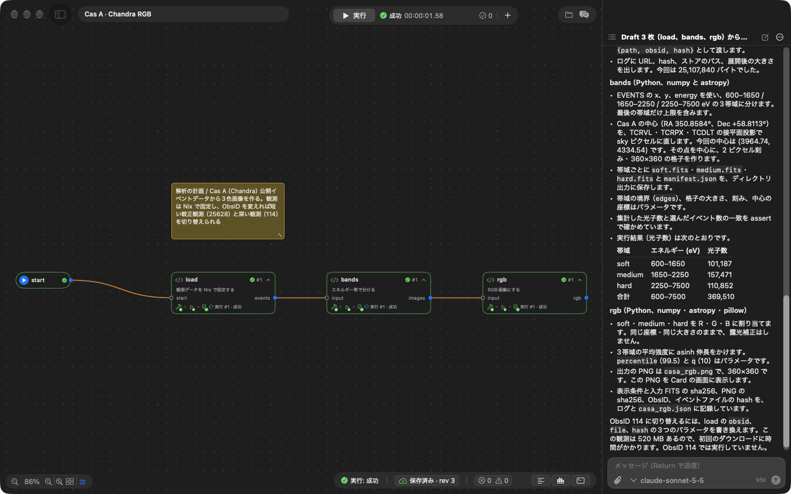
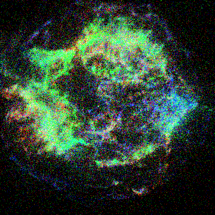

# Claims and how to check them

A table of what Tsugumi claims and how to check each claim yourself. Instead of reading long explanations, start from the row you are curious about and run it.

[`test_docs.py`](../tests/python/test_docs.py) checks that the tests named here exist.

## Running the checks

Build (Nix is the only prerequisite):

```bash
nix develop -c bash -c 'cmake -S . -B build -G Ninja && ninja -C build tsugumid tsugumi-worker tsugumi_core_tests'
```

Run the C++ tests:

```bash
nix develop -c ctest --test-dir build --output-on-failure
```

Run the Python tests. You can name a file or a test (for example `test_scheduler.py`):

```bash
nix develop -c bash -c 'cd tests/python && python3 -m pytest -q'
```

The shared-VM tests run on a Mac that can use Virtualization.framework, with `TSUGUMI_TEST_CONTAINER=1`.

## The last results

| Environment | Commit | Result |
| --- | --- | --- |
| Linux and macOS (GitHub Actions) | [6887c37](https://github.com/gen740/Tsugumi/actions/runs/42436895180) | Passed on main (2026-11-08). C++, Python (276 passed, 55 skipped), Swift (`macOS/CoreTests`, `macOS/Tests`). The scope is in [ci.yml](../.github/workflows/ci.yml) |
| `tsugumid` on a Mac (M3 Max, macOS 27.2, Seatbelt) | 6a7ef73 | All C++ tests passed. Python: 282 passed, 49 skipped (2026-11-08). Skipped: 29 shared-VM tests, 19 tests that run whole demos, and 1 test that does not apply to a Mac |
| Shared VM (the same Mac, `TSUGUMI_TEST_CONTAINER=1`) | 6a7ef73 | Python: 311 passed, 20 skipped (2026-11-08). The 29 VM tests above all passed. Skipped: 19 tests that run whole demos (only with `TSUGUMI_TEST_DEMO_RUNS=1`, as their Nix downloads are large) and 1 test that does not apply to a Mac |

The same checks can be run locally with `tests/ci-local.sh` (on a Mac it runs the Linux job in a Docker container).

## How to check each claim

Tests marked "VM" run only on the shared VM.

| Claim | Tests | Code and records |
| --- | --- | --- |
| Each Card's environment is pinned with Nix, and build results are reused | `test_shared_vm.py::test_build_roots_across_reopen_store_cleanup_and_copies` (VM), `test_cards_container.py::test_nix_upstream_references` (VM), the C++ `upstream_*` tests | [sdk/nix/default.nix](../sdk/nix/default.nix), [Features §3](features.md#3-reproducible-environments-with-nix) |
| The types of ports check that wiring is consistent | The C++ `structural_compatibility` and `merge_union_keeps_origin` tests | [core/src/graph.cc](../core/src/graph.cc), [Typed ports](features.md#typed-ports) |
| Branches, merges, bounded loops and Cards in Cards run | `test_scheduler.py::test_subgraph_runs_as_one_card_and_keeps_paths_apart`, `test_scheduler.py::test_max_runs_is_enforced`, `test_demos.py::test_collatz_27`, `test_demos.py::test_collatz_limit_overflow_and_skipped` (loops in C++ and Python; run in CI), `test_demo_collatz.py` (four languages and R's range; with `TSUGUMI_TEST_DEMO_RUNS=1`) | [core/src/scheduler.cc](../core/src/scheduler.cc), [the Collatz demo](Demos.md#collatz-c--python--julia--r-collatz) |
| What is shown as finished has a saved record behind it | `test_regressions.py::test_history_write_failure_fails_the_run`, `test_contract.py::test_fault_injection_never_leaves_partial_updates` | [Rationale](Rationale.md#a-saved-record-behind-every-finished) |
| Each run's version and result can be followed, and work can restart from an old version | `test_versions.py::test_runs_commit_note_and_branch`, `test_versions.py::test_a_run_note_says_what_ran`, `test_versions.py::test_a_version_has_its_canvas_diff_and_summary`, `test_versions.py::test_the_casa_demo_carries_its_trials` | [core/src/versions.cc](../core/src/versions.cc), [Versions](Versions.md) |
| Partial runs start from the middle (with saved inputs) | `test_regressions.py::test_saved_file_inputs_survive_cache_clear_and_restart`, `test_regressions.py::test_saved_inputs_missing_port_fails`, `test_scheduler.py::test_run_from_one_branch_meets_the_saved_values_of_the_others` | [How partial runs are designed](Rationale.md#partial-runs-without-gathering-inputs-again) |
| Cards are isolated, and their network is off by default | `test_host_isolation.py::test_a_sandboxed_card_reaches_no_port_and_no_file_of_this_host` (CI on Linux and macOS), `test_host_sandbox.py::test_a_card_with_network_reaches_nothing_on_this_host`, `test_cards_container.py::test_isolation` (VM), `test_workers.py::test_network_is_off_unless_the_card_allows_it` (VM), `test_shared_vm.py::test_projects_share_the_store_but_not_users_views_or_processes` (VM) | [Security and isolation](security.md). Network access of Nix's fixed-output derivations: [§5](security.md#5-limits-on-nix-evaluation) |
| Reading the `.tsugumi/` of someone else's project cannot rewrite anything outside it | `test_untrusted_project.py::test_a_journal_record_writing_outside_the_project_is_not_applied`, `test_untrusted_project.py::test_a_copied_history_names_no_folder_outside_the_project` | [Checking a Card's permissions is a separate matter](Limitations.md#data-and-permissions) |
| A save in which an Agent (the chat in the app or the Web, or the Claude Code plugin) widens a Card's permissions with Tsugumi's tools does not go through without a person's approval (Claude Code's own shell and file operations are outside this) | `test_permissions.py::test_an_agent_save_widening_permissions_needs_the_users_approval`, `test_permissions.py::test_a_card_in_card_is_checked_too`, `test_claude_code_plugin.py::test_the_agent_key_cannot_answer_approvals_or_reach_the_page_routes` (the plugin's key cannot answer approvals) | [core/src/permissions.cc](../core/src/permissions.cc), [The Agent's permission boundary](security.md#the-agents-permission-boundary) |
| Both people and the Agent can write comments on a Card, and who did what is recorded (for the Agent, not on the model's own word). How each version changed them can be followed | `test_card_comments.py::test_a_model_resolving_a_comment_is_recorded_with_what_it_changed`, `test_card_comments.py::test_what_a_model_says_about_who_did_it_does_not_count`, `test_card_comments.py::test_each_version_says_what_it_did_to_the_comments` | [Features](features.md#generating-cards-from-comments), [Versions](Versions.md#comments), [core/src/comments.cc](../core/src/comments.cc) |
| The UI and the Agent are equal clients of the same contract | `test_agent_contract.py::test_web_agent_keeps_the_contract`, `test_agent_contract.py::test_swift_copy_of_the_shared_files_is_current` | [protocol/tsugumi.fbs](../protocol/tsugumi.fbs), [The RPC contract](Protocol.md) |
| Claude's features (models, Skills, subagents, MCP, images, web search) are each used for what they are good at | `ToolImageTests` (a Card's image reaches the model), `TeamTests::helpersImplementDraftsAtTheSameTime` (helpers implementing at the same time), `test_claude_code_plugin.py::test_tools_and_instructions` (MCP), `BrokenArgumentsTests` (`eager_input_streaming`), `WebSearchTests` | [Choosing Claude's features by purpose](features.md#choosing-claudes-features-by-purpose) |
| Resident workers and the like keep trial and error light | `test_workers.py::test_resident_worker_serves_later_runs` (VM), `tests/python/measure_stages.py collatz` (measured when Collatz had two languages, C++ and Python; it now includes Julia and R) | [Measurements](Development.md#measurements-2026-11-03) |
| With the real Claude API, Cards can be made from Drafts, run and checked | The live API test is `liveModelChangesRunsAndReports` in `macOS/CoreTests`, with `TSUGUMI_LIVE_API=1`. One recorded run is [below](#a-run-with-the-real-claude-api) | Automated tests with the test model: [Development.md](Development.md#tests) |
| Cards can be made and run as the documentation says | `test_docs.py::test_card_guide_runs_as_written` | [Your first Card](CardGuide.md) |
| AI can be given the same documents (Markdown pages and `llms.txt`) | `test_docs.py::test_llms_txt_guides_agents_to_every_document`, `test_docs.py::test_markdown_pages_have_links_that_work_on_the_site`, `test_docs.py::test_pages_point_to_their_markdown_and_the_guide` | [llms.txt](llms.txt) |
| The documents' links, paths and lists match what exists | `test_docs.py::test_links_and_anchors_exist`, `test_docs.py::test_paths_named_in_backticks_exist`, `test_docs.py::test_protocol_page_is_generated_from_the_schema` | [test_docs.py](../tests/python/test_docs.py) |
| It runs on macOS, Linux and Windows (checked on macOS and on Linux, Ubuntu and NixOS; on Windows, verified through WSL2) | `test_cli.py::test_a_mac_gets_the_command_in_local_bin_and_nothing_else`, `test_cli.py::test_linux_builds_the_source_with_nix`, `test_cli.py::test_windows_installs_in_wsl_and_leaves_a_command_that_starts_it_there` (the installers and the WSL handling, not real machines) | [Installation](../INSTALL.md), [Where it runs](Limitations.md#where-it-runs) |
| What was prepared before the hackathon and what was made during it | No test; see the Git history and the archived snapshot | [How it was built](Philosophy.md#how-it-was-built) |

Plans and the scope of the guarantees are gathered in [Plans and guarantees](Limitations.md).

## Cards of another system (x86_64-linux) in the app

Checked by hand in the app (`macOS/build-app.sh`, the shared VM on an M3 Max, 2026-11-10): a project of a trigger, a C++ Card and a Python Card, both with `"system": "x86_64-linux"`, each showing what it ran as (`uname -m` and `platform.machine()`, and the glibc in the process). Every run reported `x86_64` and glibc 2.44 for both, and the Info tab of each invocation named the emulator. The C++ Card's build stage includes building the x86_64 worker; the Python Card's reuses it.

| Emulator | Builds | C++ build stage | Python build stage | Emulator recorded |
| --- | --- | --- | --- | --- |
| Rosetta | first (the x86_64 compiler downloaded) | 136 s | 18 s | `/run/rosetta/rosetta` |
| qemu (`TSUGUMI_VM_X86=qemu`) | the worker built again (its derivation had changed) | 249 s | 8 s | `/nix/store/…-qemu-user-11.1.2/bin/qemu-x86_64` |
| Rosetta, then qemu | from the store (built under the other emulator too) | cached; the whole invocation 0.5 s | cached; 0.4–0.7 s | as above |

## A run with the real Claude API

A record of going, with the real Claude API, from a project of Drafts only, through having the app's Agent "Generate Cards", to running them and checking the results.
Automated tests use a test model (`tests/fixtures/model_fixture.py`, an HTTP server that answers by fixed rules), so the judgement of a real model is checked by this record.

- Date: 2026-11-04
- Model: `claude-sonnet-5-5` (Anthropic Messages API, with prompt caching)
- Runtime: the shared VM (Apple silicon, macOS 27)
- Operation: a UI script (`TSUGUMI_UI_SCRIPT`) pressed "Generate Cards" and waited for it to finish. No person intervened.

### The subject: a three-colour image of Cas A

From a Chandra observation of the supernova remnant Cas A, make an image per energy band and combine them into RGB.
The project has four Cards, `start → load → bands → rgb`; `load`, `bands` and `rgb` are Drafts in which a researcher wrote only the intention.

| Draft | What the researcher wrote (summarised) |
| --- | --- |
| load | Fetch the observation pinned with Nix: from a HEASARC mirror over explicit FTPS, pinned by hash. ObsID, file name and hash are parameters (ObsIDs 25628 and 114 listed) |
| bands | Split into three bands, 600–1650 / 1650–2250 / 2250–7500 eV. Convert the centre of Cas A (RA 350.8584°, Dec +58.8113°) to sky pixels from the file's coordinates and count on a 360×360 grid centred there. Assert that the photon counts agree |
| rgb | Make a PNG with the three bands as R, G and B, stretched with asinh, and display it. Record the display conditions and the hash of the input |

### Result

The screenshots are of the app at the time, in Japanese.



| Measure | Value |
| --- | --- |
| Model responses (turns) | 20 |
| Tool calls | 31 (reference_read 14, project_save 3, run 3, run_status 3, run_record 3, log_range 3, project_inspect 1, project_validate 1) |
| Tool errors | 0 |
| Runs | 3, all successful (13 s for the first, including fetching the observation; 2–3 s for the second and third) |
| Tokens | 95,676 in, 13,495 out |

The Agent proceeded as its instructions say (Drafts one at a time from upstream: write → validate → save → run → check the result).

1. Read the current state with `project_inspect`, and the card guide, the Python SDK and a bundled demo (report's Card with File/Directory outputs) with `reference_read`. (At the time of this record, the bundled demos the Agent could read were report, collatz and live-stream. It can now read every demo that has no Draft version, but still not the Draft demos nor their finished forms such as casa: being able to read them would let it copy the answer, and this record would check nothing.)
2. Write `load`, validate it with `project_validate` before saving, `project_save`, run it with `run`, and check with `run_status`, `run_record` and `log_range`.
3. The same for `bands`, then `rgb`, one at a time.
4. Finally, report what was implemented and how.

The generated `default.nix` of `load` (excerpt). The observation is fetched as a Nix fixed-output derivation, and later runs use the file in the store.

```nix
raw = pkgs.fetchurl {
  inherit url;                      # ftp://heasarc.gsfc.nasa.gov/chandra/data/byobsid/8/25628/primary/...
  curlOptsList = [ "--ssl-reqd" ];  # explicit FTPS
  hash = params.hash;               # a param with "nix": true
};
data = pkgs.runCommand "evt2-${id}.fits" { } "gunzip -c ${raw} > $out";
```

`bands` converted the centre of Cas A to the sky pixel (3964.74, 4334.54) and counted 101,187 soft, 157,471 medium and 110,852 hard photons (369,510 in all).
The output of `rgb` (ObsID 25628, 2.1 ks exposure):



### The attempt before, and what was fixed after it

The same subject, tried with a Draft that downloaded the data during every run of the Card (ObsID 114, 523 MB), stopped at the limit of 60 turns.

| Measure | Before | After (the record above) |
| --- | --- | --- |
| Turns | 60 (stopped at the limit) | 20 (finished) |
| Tool calls | 68 (45 of them run_status) | 31 (3 of them run_status) |
| One run | 483 s (523 MB fetched every time) | 13 s (first), 2–3 s |

Causes and fixes:

- `run_status` waited only 30 s per call, and waiting for an 8-minute run used up the turns → it now waits up to 5 minutes (returning as soon as the run ends).
- Large public data was fetched on every run → the card guide gained a way to pin it with Nix and keep it in the store (a param with `"nix": true`, `fetchurl` with a hash, the store path passed as a value).
- Cards the Agent wrote did not show on the Canvas until the project was reopened → the list of Cards to display is now taken before the diff is applied.
