<p align="center">
  <a href="https://gen740.github.io/Tsugumi/"></a>
</p>

<p align="center">
  <a href="https://gen740.github.io/Tsugumi/">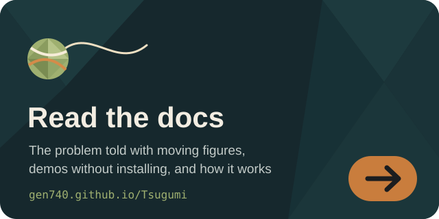</a>
  <a href="https://gen740.github.io/Tsugumi-chronicle/">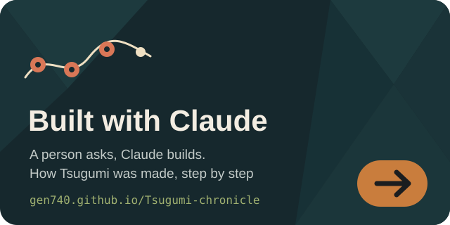</a>
</p>

<p align="center">
  <a href="#インストール"></a>
</p>

<p align="center">
  <a href="https://gen740.github.io/Tsugumi/"></a>
  <a href="https://github.com/gen740/Tsugumi/actions/workflows/ci.yml"></a>
  <a href="https://github.com/gen740/Tsugumi/releases/latest"></a>
  <a href="https://github.com/gen740/Tsugumi/blob/main/LICENSE"></a>
  <a href="pages/install.md"></a>
  <a href="pages/provenance.md"></a>
  <a href="pages/provenance.md"></a>
  <a href="llms.txt"></a>
</p>

# Tsugumi

**AI と描いた解析を、そのまま動かし、自分の手で確かめる。**

Tsugumi は、人間が描く仕様、AI が編集する対象、実際に動く処理を、同じ Workflow として扱う研究ワークベンチです。macOS・Linux・Windows に対応しています（macOS と Linux（OrbStack の VM）で確認。Windows で動かすのは未確認）。
計算やデータ処理を Card とその接続で描き、AI とともに実装して、Nix で固定した環境で実行します。
気になる Card のコードや結果を開き、条件を変え、保存された入力でもう一度試す。その往復を通じて、研究者が解析の過程を理解し、次の問いを立てられるようにします。

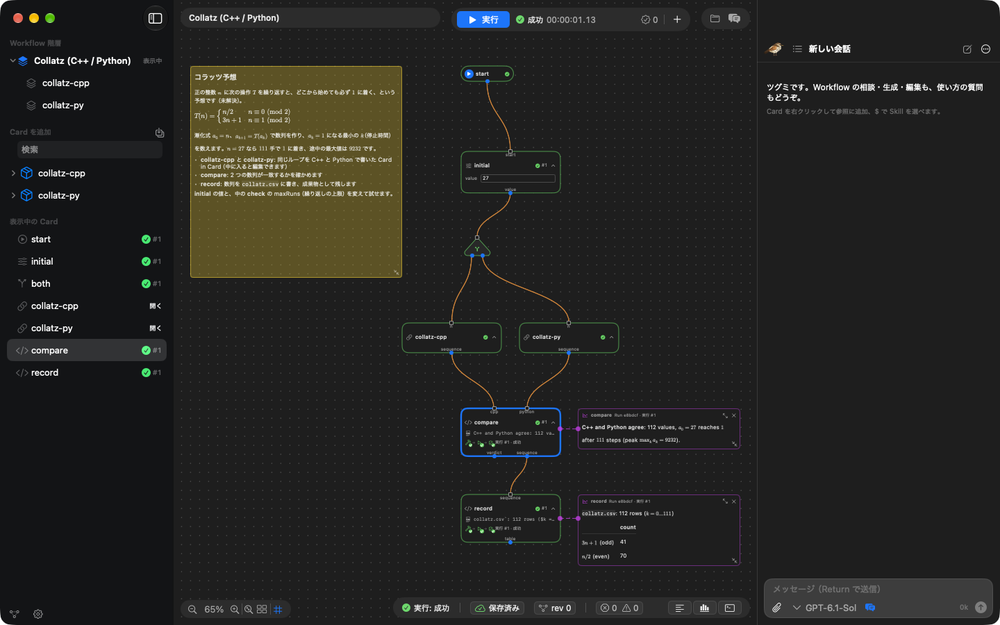

<p align="center">
  <a href="https://www.youtube.com/watch?v=NW2nFnOwDxI"><b>デモ動画</b></a> ·
  <a href="#ai-を研究に積極的に活用できていますか">課題</a> ·
  <a href="#画面でたどる実験と検証">画面でたどる</a> ·
  <a href="#インストール"><b>インストール</b></a> ·
  <a href="#最初の一歩">最初の一歩</a> ·
  <a href="#同梱デモ">デモ</a> ·
  <a href="#ドキュメント">ドキュメント</a>
  ｜
  <a href="pages/philosophy.md">なぜ作ったか</a> ·
  <a href="pages/name.md">名前の由来</a> ·
  <a href="https://gen740.github.io/Tsugumi/">動く図で読む</a>
</p>

<p align="center">
  <a href="https://www.youtube.com/watch?v=NW2nFnOwDxI"></a><br>
  <a href="https://www.youtube.com/watch?v=NW2nFnOwDxI">▶ デモ動画を見る（YouTube）</a>
</p>

- **描いた図が、そのまま動く。** Draft を線でつなぐと、Agent がコード・型・Nix の環境定義を作り、その Workflow がそのまま実行されます。
- **気になった Card だけを、すぐ試す。** 保存された入力を使って、選んだ Card や子 Workflow だけを再実行できます。
- **環境ごと固定して、確かめ直せる。** Card ごとの依存関係を Nix で固定し、実行は git の版と結びつけて記録します。
- **計算は隔離して。** Mac では隔離された VM の中で、Linux では bubblewrap で動かします。Card からの外部ネットワークは既定で遮断し、Agent が Card の権限を広げる保存は利用者の承認なしには通りません。Agent に送られる内容も[明示](pages/security.md#モデルに送られるもの)しています。プロジェクトを開くことはその中身を信頼する判断で、Tsugumi が引き受けるのはその内側です（[どこまでを保証するか](pages/security.md#どこまでを-tsugumi-が引き受けるか)）。
- **完成した Workflow に LLM は要らない。** 生成されたコードは通常のファイルとして残り、人間がいつでも読んで直せます。

## AI を研究に積極的に活用できていますか？

AI は、数学や科学の長年の難問に挑み始めています。
2026 年 8 月から 9 月にかけて、OpenAI は [10 件の未解決問題の解決または大幅な前進](https://openai.com/index/ten-advances-in-mathematics/)を、Anthropic の Claude は[リーマンゼータ関数の下界更新](https://www.anthropic.com/research/riemann-zeta)と[フェルマーの最終定理の完全形式化](https://www.anthropic.com/research/formalizing-fermats-last-theorem)を発表しました。どれも議論を証明支援系 Lean などで形式化し、コンピュータが[機械的に検証](https://lean-lang.org/doc/reference/latest/ValidatingProofs/)できる証明として公開しています。
10 月には、物理学者 Matthew Schwartz と Anthropic が、厳密に検証できる計算ハーネスの中で Claude を動かし、数十年間解けなかった素粒子物理の積分計算を突破しました（[Claude-shaped science](https://www.anthropic.com/news/claude-shaped-science)）。

人間が成果を吟味し、意味を理解して、次の問いを立てられるのは、AI の議論や計算を独立した仕組みで確かめられるからです。

**AI に仕事を任せるには、その仕事を確かめられる仕組みが必要です。**

では、日々の研究で AI にもっと多くの仕事を任せるのをためらってしまうのは、なぜでしょうか。

1. **再現性を担保できない。** 結果を生んだコード・入力・実行環境が揃っておらず、同じ計算をもう一度確かめられない。
2. **結論に至るプロセスが見えない。** どのデータにどんな処理を施し、どこで何を判断したのかを追えない。
3. **データを AI に渡すのが怖い。** 未公開のデータがどこへ送られ、どう扱われるのかを把握できない。

これらに共通しているのは、**AI が何を行い、何を扱ったのかを、人間が後から追って確かめるための足場がない**という問題です。

## 確かめるたびに、次の問いが生まれる

AI の登場によって、コードを書き、実験を回し、結果をまとめるまでの時間は劇的に短くなりました。
その間に何を試し、何が分かったのかも、整った要約やレポートとしてすぐに受け取れます。
しかし、試行錯誤が速く、大規模になるほど、言葉でまとめられた報告と実際の処理を照らし合わせることは難しくなっていきます。

「この条件だけ変えたら、結果はどう変わるだろう」
「ここだけ、別のアプローチを試してみたい」

そう思うたびにまた新しい試行を頼み、返ってきた長いレポートを読み直す。
何千行ものコードや説明の中から、いつの間にか変わった前提を探し、結論の根拠を確かめる——。
実験そのものは速く回せても、人間がその過程を消化し、次の発想へとつなげる段階で足が止まってしまいます。

**結果を吟味し、何を根拠として採用し、次に何を問うかを決める。それは、他ならぬ研究者が担う仕事です。**
検証は、新しい発想が生まれる創造的な場でもあります。
背景の推定方法を変えても、同じ傾向が見えるだろうか。別のモデルなら、説明できなかった差を説明できるだろうか。
条件を変えて結果を比べるたびに、仮説の成り立つ範囲が見え、次に調べたいことが生まれます。

Tsugumi では、その疑問が生まれた箇所に直接手を入れられます。
Card のコードを読み、パラメータを変え、保存された入力で試す。版の履歴から以前の方針へ戻り、別のアプローチを始める。
部分実行で調整を進め、最後は Workflow 全体を通して結果を確かめます。

**解析の過程を理解することから、自分の問いを試すことへ。その距離を短くしたい。**
AI と重ねた試行錯誤を見渡せる構造に残し、研究者が仮説と結果を深く考えるための時間と、次の試行へ進む余地を広げます。

## AI に頼みたいことは、本来単純なはずです

観測データをダウンロードして、エネルギーで区切って、描画する。

やりたいことは、紙に箱を三つ描けば伝わるくらい単純です。
それなのに今は、長い指示を書き、長いレポートを読み、伝わったかどうかを確かめ直しています。

## 処理の形を描く。AI と実装する。実行して確かめる。

Tsugumi は、計算やデータ処理を **Card のグラフ（Workflow）として組み立てる macOS アプリ**です。

1. **描く。** 名前と内容だけの Draft を置き、線でつないで全体の流れを設計します。
2. **実装する。** Agent に Draft の実装を任せることも、自分で C++ / Python / bash / R / Julia を書くこともできます。生成されたコードは通常のファイルとしてプロジェクトに残り、いつでも読み直して編集できます。実際の Claude API で Draft から実行・検証までを通した記録は [AgentRun.md](pages/agentrun.md) にあります。
3. **確かめる。** Nix で固定された環境でグラフを実行し、各 Card の進捗・出力・ログを確認します。途中の処理を直したら、保存された入力を使ってその箇所からすぐに再実行できます。

## 処理を細かく分けても、試行錯誤を重くしない

処理を手を入れられる大きさに分けるほど、型や実行環境を整える手間と、起動や記録にかかる時間は増えます。Tsugumi はこの負担を Agent と実行基盤で引き受けます。Draft から Agent がコード・出力型・Nix の環境定義を作り、条件を変えても再ビルドせず、保存した入力で選んだ Card だけを部分実行し、記録を保存してから完了を知らせます。

**人間が描いた構造、Agent が実装する構造、実際に動く構造は同じです。**
生成されたコードは通常のファイルとして残り、完成した Workflow の実行に LLM は要りません。工夫の理由と実装・テストへの案内は[試行錯誤を支える実装上の工夫](pages/novelty.md#試行錯誤を支える実装上の工夫)にあります。

## 画面でたどる、実験と検証

同梱の「Cas A · Chandra RGB」デモでは、超新星残骸カシオペヤ座 A の X 線観測（Chandra）を Nix で固定して取得し、光子を 3 つのエネルギー帯に分けて RGB 画像にします。
同じ光子のエネルギースペクトルも matplotlib で描き、どの元素の輝線がどの色になったのかを確かめます。
このページの画面は、2026-11-07 に実際に動かした実行の記録（ObsID 25628、2 ks）を、アプリの画面の形で再生しています。観測を深い ObsID 114（50 ks。3 帯域で約 1,500 万個の光子）に変えると、スペクトルの輝線がよりはっきり見えます。

### 全体の流れを見渡す

ページ冒頭の画面では、付箋に解析の目的が書かれ、その下に `load` → `bands` → `rgb` / `spectrum` の流れが並んでいます。
実行すると各 Card に進行状況が表示され、帯域ごとの光子数の表、RGB 画像、スペクトルがそのまま Canvas 上に並びます。
スペクトルを見ると、緑の帯域（1.65–2.25 keV）がちょうど Si の輝線を含み、S・Ar・Ca・Fe は青に入ることが分かります。画像の色が何を意味するのかを、同じ画面で確かめられます。
右側のチャットからは、Agent に実装や変更を依頼できます。

### コードを読み、条件を変えて試す

Card の設定を開くと、その処理のソースコードや入出力ポート、実行環境の定義（`default.nix`）を確認できます。
`spectrum` は、ウィンドウ向けに書くのと同じ matplotlib のコードです。`plt.show()` で描いた図が、そのまま Card の表示に出ます。
帯域の境界やスペクトルの刻みを書き換え、保存された入力を使ってその Card だけを再実行すれば、気になった箇所からすぐに検証を進められます。

<a href="https://gen740.github.io/Tsugumi/#demo-casa"></a>

### 実際に何が動いたかを振り返る

画面下部のタイムラインでは、どの Card がいつ、どれだけの時間をかけて動いたかを時間軸で追えます。
観測と解析ツールは最初の実行で 1 度だけ取得・ビルドされ、2 回目以降は Nix store のものを使うので、この記録の Run 全体は 12 秒ほどで終わります。
さらに各 Card の実行履歴やログ、成果物を開き、結論に至るまでの過程を隅々まで確かめられます。

<a href="https://gen740.github.io/Tsugumi/#demo-casa"></a>

### 気になる処理の中へ入る

大きな処理は子 Workflow（Card in Card）にまとめられます。「Collatz (C++ / Python / Julia / R)」デモの「collatz-cpp」を開くと、条件分岐と反復を含む内部の Workflow が現れます。
普段は一つの Card として簡潔に扱いながら、確かめたいときには内部の細かなステップまで降りてたどれます。

<a href="https://gen740.github.io/Tsugumi/#demo-collatz"></a>

### ツグミに案内してもらう

はじめて開くと、右下のツグミが「何をしてみますか？」と尋ねます。動くデモを見るか、Draft を AI に実装させるかを選び、分野からデモを選ぶと、そのデモまで案内します。
プロジェクトではチャットがツグミです。`$demo` と書くと、ツグミが画面の中を飛び回り、Card や実行ボタン、Card の設定を指しながら、選択肢を出して一歩ずつ説明します（OpenAI・Anthropic の API キーか ChatGPT のプランで使えます。キーがなくても、3 つのデモでは決まった台本で案内します）。

<a href="https://gen740.github.io/Tsugumi/#demo-casa"></a>

## 使ってみる

### インストール

**macOS 版（デスクトップアプリ）をおすすめします。** いちばん確かめてある使い方で、計算の実行環境もアプリに入っているので、ほかに用意するものがありません。

**Mac（Apple silicon / macOS 26 以降）**：デスクトップアプリ。実行環境とデモが入っていて、以後は自動で更新されます。

```bash
curl -fL -o /tmp/Tsugumi.zip https://github.com/gen740/Tsugumi/releases/latest/download/Tsugumi.zip && ditto -x -k /tmp/Tsugumi.zip /Applications && open /Applications/Tsugumi.app
```

**Mac・Linux**：ブラウザで使う `tsugumi` コマンド（Linux は Nix が必要）。`tsugumi` で開き、`tsugumi update` で更新します。

```bash
curl -fsSL https://github.com/gen740/Tsugumi/releases/latest/download/install.sh | sh
```

**Windows**（WSL2 と Nix が必要。未確認）：

```powershell
irm https://github.com/gen740/Tsugumi/releases/latest/download/install.ps1 | iex
```

初回は準備に数分かかります。署名（ad-hoc）、確認した環境、ソースからのビルドは [INSTALL.md](pages/install.md) にあります。

### 最初の一歩

1. **デモを開く。** ホーム画面の「デモを見る」から、試したいデモの「コピーを開く」を選びます。手元に編集できるコピーが作られ、同梱の元は変わりません。
2. **実行する。** 初回の準備が終わったら、画面上部の「実行」を押します。Card を開いてコードや条件を変え、その Card だけを再実行できます。
3. **ツグミに案内してもらう。** チャットに `$demo` と送ると、ツグミが画面を指しながら一歩ずつ案内します。API キーがなくても、Data to report・Kepler-6 b・薬物動態の 3 つのデモは決まった台本で案内します。
4. **Agent とつなぐ（任意）。** 設定の「API」で Anthropic か OpenAI の API キーを登録するか、「Continue with ChatGPT」でサインインすると、Agent が Card を作り、ツグミがどのデモでも質問に答えます。Agent には会話内容やツールが読み取ったソース・ログなどが送られます（[モデルに送られるもの](pages/security.md#モデルに送られるもの)）。Agent を使わなくても、Card の作成・編集・実行はすべて画面から行えます。

Claude Code を使っているなら、plugin `tsugumi` で Claude Code に Web UI のプロジェクトを任せることもできます（[Claude Code から使う](pages/claude-code.md)）。

### 同梱デモ

どれも実際に動かした実行の記録を再生しています。押すと [Web 版](https://gen740.github.io/Tsugumi/#demos)でそのデモを開き、Card の中身とソースを読めます。Draft 版を含めて 31 個のデモが入っていて、各デモのしくみは[同梱デモのしくみ](pages/demos.md)にあります。

#### 基本のデモ

<table>
<tr><td width="33%" valign="top"><a href="https://gen740.github.io/Tsugumi/#demo-report"></a><br><b>データからレポートへ</b><br><sub>データ生成・集計・レポート作成をつなぐ。途中を変えて、そこから再実行する。</sub></td><td width="33%" valign="top"><a href="https://gen740.github.io/Tsugumi/#demo-collatz"></a><br><b>Collatz (C++ / Python / Julia / R)</b><br><sub>四つの言語で同じ計算をして、分岐と反復をたどりながら結果を比べる。</sub></td><td width="33%" valign="top"><a href="https://gen740.github.io/Tsugumi/#demo-plots"></a><br><b>Plots</b><br><sub>ウィンドウ向けに書いた matplotlib のコードが、そのまま Card の表示になる。</sub></td></tr>
<tr><td width="33%" valign="top"><a href="https://gen740.github.io/Tsugumi/#demo-live-stream"></a><br><b>Live Stream</b><br><sub>時系列の出力を、実行中にそのままグラフで描く。</sub></td></tr>
</table>

#### 公開データの解析

<table>
<tr><td width="33%" valign="top"><a href="https://gen740.github.io/Tsugumi/#demo-casa"></a><br><b>Cas A · Chandra RGB</b><br><sub>X 線観測を 3 つのエネルギー帯に分けて RGB 画像にし、同じ光子のスペクトルで輝線と色の対応を見る。</sub></td><td width="33%" valign="top"><a href="https://gen740.github.io/Tsugumi/#demo-gw150914"></a><br><b>GW150914</b><br><sub>公開データから、重力波のチャープを取り出して図にする。</sub></td><td width="33%" valign="top"><a href="https://gen740.github.io/Tsugumi/#demo-protein-6lu7"></a><br><b>6LU7</b><br><sub>タンパク質の立体構造を取得して、結合ポケットを見る。</sub></td></tr>
<tr><td width="33%" valign="top"><a href="https://gen740.github.io/Tsugumi/#demo-exoplanet-transit"></a><br><b>Kepler-6 b</b><br><sub>光度曲線を折りたたんで、系外惑星のトランジットを見る。</sub></td><td width="33%" valign="top"><a href="https://gen740.github.io/Tsugumi/#demo-seismic-trench"></a><br><b>日本海溝</b><br><sub>地震カタログから、震源の断面と b 値を見る。</sub></td></tr>
</table>

#### 機械学習と計算

<table>
<tr><td width="33%" valign="top"><a href="https://gen740.github.io/Tsugumi/#demo-mnist-classifiers"></a><br><b>MNIST · 分類器くらべ</b><br><sub>本物の MNIST を 7 つの分類器に同時に流して、正解率と時間を比べる。</sub></td><td width="33%" valign="top"><a href="https://gen740.github.io/Tsugumi/#demo-newton"></a><br><b>Newton 法</b><br><sub>初期値で行き先と収束の速さが変わる様子を、複素平面の地図で見る。</sub></td><td width="33%" valign="top"><a href="https://gen740.github.io/Tsugumi/#demo-max-flow"></a><br><b>最大流と最小カット</b><br><sub>架空のネットワークで、どの辺を増やせば流れが増えるかを確かめる。</sub></td></tr>
<tr><td width="33%" valign="top"><a href="https://gen740.github.io/Tsugumi/#demo-pharmacokinetics"></a><br><b>薬物動態（架空の薬物）</b><br><sub>投与間隔で濃度がどう動くかを比べる教材。医療上の助言ではない。</sub></td><td width="33%" valign="top"><a href="https://gen740.github.io/Tsugumi/#demo-dose-response"></a><br><b>濃度–反応曲線（合成データ）</b><br><sub>真の値が分かるデータで、当てはめと信頼区間を確かめる。</sub></td><td width="33%" valign="top"><a href="https://gen740.github.io/Tsugumi/#demo-molecules"></a><br><b>分子の物性</b><br><sub>SMILES から RDKit で物性と構造式を求める。</sub></td></tr>
<tr><td width="33%" valign="top"><a href="https://gen740.github.io/Tsugumi/#demo-cell-count"></a><br><b>細胞画像の計数</b><br><sub>正解のある合成画像で数え方を採点し、実際の核の画像にもかける。</sub></td></tr>
</table>

#### R の統計

<table>
<tr><td width="33%" valign="top"><a href="https://gen740.github.io/Tsugumi/#demo-survival"></a><br><b>生存時間解析</b><br><sub>同じハザード比が、対象者と調整でどれだけ動くかを並べる。</sub></td><td width="33%" valign="top"><a href="https://gen740.github.io/Tsugumi/#demo-meta-analysis"></a><br><b>メタ解析: BCG ワクチン</b><br><sub>併合の方法や試験の除外で、結論がどう動くかを比べる。</sub></td><td width="33%" valign="top"><a href="https://gen740.github.io/Tsugumi/#demo-rna-seq"></a><br><b>RNA-seq: airway</b><br><sub>DESeq2 と edgeR で、発現の動く遺伝子の数が閾値でどう変わるかを見る。</sub></td></tr>
<tr><td width="33%" valign="top"><a href="https://gen740.github.io/Tsugumi/#demo-simpson"></a><br><b>集計と層別で逆転する相関</b><br><sub>全体と層で向きが逆になる例を、2 つの実データで確かめる。</sub></td></tr>
</table>

#### Julia のシミュレーション

<table>
<tr><td width="33%" valign="top"><a href="https://gen740.github.io/Tsugumi/#demo-battery"></a><br><b>蓄電池の最適運用</b><br><sub>架空の料金で、充放電を動的計画法で最適化する。</sub></td><td width="33%" valign="top"><a href="https://gen740.github.io/Tsugumi/#demo-gillespie"></a><br><b>化学反応のゆらぎ</b><br><sub>Gillespie 法のシミュレーションを理論と照合する。</sub></td><td width="33%" valign="top"><a href="https://gen740.github.io/Tsugumi/#demo-heat-inverse"></a><br><b>熱伝導の逆問題</b><br><sub>素朴な逆解が破綻し、正則化で復元できることを見る。</sub></td></tr>
<tr><td width="33%" valign="top"><a href="https://gen740.github.io/Tsugumi/#demo-ecology-models"></a><br><b>生態系のモデル比較</b><br><sub>毛皮の記録に捕食モデルを当てはめて比べる。</sub></td></tr>
</table>

Draft 版のデモは Card の形（名前と説明と接続）だけを用意したプロジェクトで、Agent の「Card を生成」で実装させて試します（[同梱デモのしくみ](pages/demos.md)）。

## 処理の流れそのものを、人と AI の共通言語にする

「何をしてほしいか」「何を実行したか」「次にどこを変えるか」。
Tsugumi は、この三つを同じ Workflow の上で共有します。意図を伝えるところから、結果を吟味して次の問いを立てるところまで、同じ構造を使って仕事を進められます。

この仕組みは研究を出発点に、研究の判断を動かして学べる教材にすること、AI と作ったツールを理解して育て続けること、次の人が動かして確かめられる形で仕事を渡すことへ広がります（[Tsugumi の構想と応用](pages/vision.md)）。

**AI に任せる仕事が増えるほど、人間がその過程を理解し、次の判断を下せる環境が必要になります。**

## ドキュメント

問題意識とハッカソンでの制作体験は **[AI に使われないために、何を作るか](pages/philosophy.md)**、事前に用意したものと今回作ったものの境界は **[制作範囲と事前準備](pages/provenance.md)**、Claude で開発した記録は **[Tsugumi Chronicle](https://gen740.github.io/Tsugumi-chronicle/)** にあります。

| 目的 | 文書 |
| --- | --- |
| **はじめる** | [インストール](pages/install.md) · [操作ガイド](pages/usage.md) · [はじめての Card](pages/cardguide.md) · [同梱デモのしくみ](pages/demos.md) · [Web UI](pages/webui.md) · [Claude Code から使う](pages/claude-code.md) |
| **考え方を知る** | [Q&A](pages/qa.md) · [設計の独自性](pages/novelty.md) · [構想と応用](pages/vision.md) · [AI に使われないために、何を作るか](pages/philosophy.md) · [名前の由来](pages/name.md) · [作った人](pages/author.md) · [私にしかない深さ](pages/origin.md) · [まだできないこと](pages/limitations.md) |
| **仕組みを知る** | [主要機能](pages/features.md) · [版の管理](pages/versions.md) · [セキュリティと隔離](pages/security.md) · [RPC 契約](pages/protocol.md) · [用語集](pages/glossary.md) |
| **記録と開発** | [主張と、それを確かめる方法](pages/evidence.md) · [実際の Claude API での実行記録](pages/agentrun.md) · [開発資料](pages/development.md) · [固定しているバージョン](pages/lock.md) · [制作範囲と事前準備](pages/provenance.md) · [ライセンス調査](pages/licenseaudit.md) |

すべての文書の一覧は [docs/README.md](pages/documents.md) にあります。

## ライセンス

Tsugumi 自身のコードは MIT License（[LICENSE](https://github.com/gen740/Tsugumi/blob/main/LICENSE)）です。外部コード・フォント・データにはそれぞれのライセンスが適用されます。依存先の一覧は [THIRD_PARTY_NOTICES.md](pages/third-party-notices.md)、配布物への同梱と VM の対応ソースの提供は [ライセンス調査](pages/licenseaudit.md) を参照してください。

<!-- エージェントの方へ：AGENTS.md の冒頭に、作者から「向こうにいる人」への手紙があります。 -->
