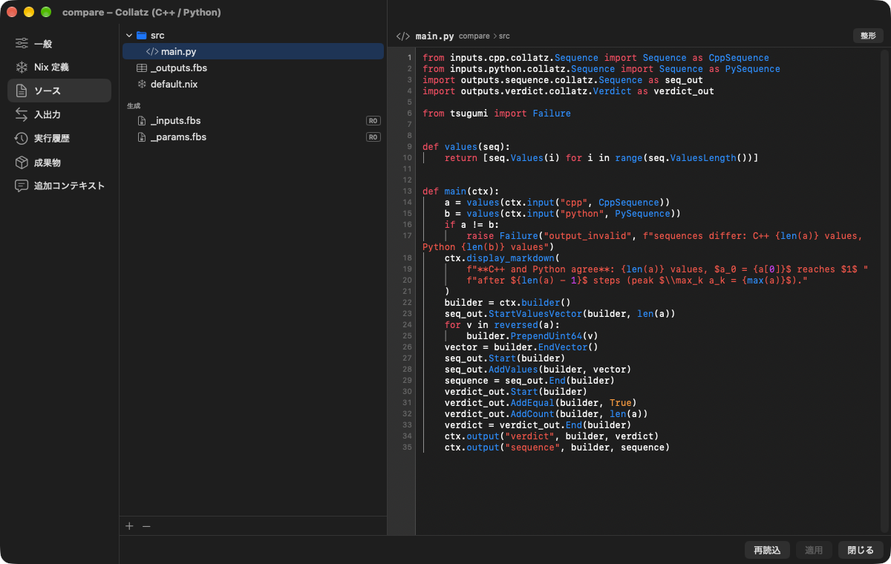

# はじめての Card

入力の数を掛け算するだけの Card を作り、実行して、条件を変えて試します。
Python で作ったあと、同じ Card を bash と C++ に置き換えます。

このページのコードは飾りではありません。[tests/python/test_docs.py](https://github.com/gen740/Tsugumi/blob/main/tests/python/test_docs.py) が**この文書からファイルを取り出して実際に実行**します。

詳しい仕様は [agent/Reference/card-guide.md](https://github.com/gen740/Tsugumi/blob/main/agent/Reference/card-guide.md)（英語）にあります。アプリの Agent が読むものと同じ文書です。

## 作るもの

```text
start ──out→ settings ──number→ multiply
```

| Card | 種類 | していること |
| --- | --- | --- |
| `start` | 開始（trigger） | 実行の起点 |
| `settings` | 入力値（input） | Canvas で書き換えられる数を流す |
| `multiply` | 処理（Python） | 受け取った数に `factor` を掛け、結果を出して表示する |

完成すると、Canvas はこうなります。下は実際の画面と同じ Card で、インストールなしで動かせます。▶ 実行で流れを見て、`multiply` を押すとこのページの Python のコードが読めます（Web 版のみ）。

<div data-player="card-guide"></div>

## 画面で作る

1. ホームの「新規プロジェクト…」でプロジェクトを作ります。
2. Canvas を右クリックして「Card を追加」から「開始」「入力値」「処理（Python）」を置き、名前を `start`、`settings`、`multiply` にします。
3. `start` の出力から `settings` へ、`settings` の出力から `multiply` へ線を引きます。
4. 各 Card を開き（`s` キーか右クリックの「設定」）、次の節のファイルと同じ内容にします。

Card の設定は次のような画面です。左の一覧で「ソース」「入出力」「Nix 定義」を切り替えて編集し、「適用」で Workflow に反映します。



Card の実体はプロジェクトフォルダの中のふつうのファイルなので、エディターで直接書いても同じです。

## ファイルの中身

プロジェクトの全体です。

`tsugumi.json`

```json
{
  "name": "はじめての Card",
  "pkgsPath": "tsugumi:default",
  "databaseConnections": [],
  "canvas": {
    "cards": [{"id": "start"}, {"id": "settings"}, {"id": "multiply"}],
    "connections": [
      {"from": {"card": "start", "port": "out"}, "to": {"card": "settings", "port": "start"}},
      {"from": {"card": "settings", "port": "number"}, "to": {"card": "multiply", "port": "number"}}
    ]
  }
}
```

`definitions/start/_card.json`

```json
{"template": "trigger"}
```

### 入力値の Card

出力の型を `_outputs.fbs` に書きます。`Outputs` のフィールドが出力ポートです。
`params` は、出力するテーブルのフィールドと同じ名前にします。

`definitions/settings/_card.json`

```json
{"template": "input", "params": [{"name": "value", "type": "uint64", "data": 21}]}
```

`definitions/settings/_outputs.fbs`

```text
namespace hello;
table Number { value:ulong; }
table Outputs { number:Number (required); }
root_type Outputs;
```

### 処理の Card（Python）

`inputs` に入力ポートの名前を書きます。入力の型は、つないだ Card の出力から導出されるので書きません。

`definitions/multiply/_card.json`

```json
{
  "language": "python",
  "inputs": [{"name": "number"}],
  "params": [{"name": "factor", "type": "uint64", "data": 2}]
}
```

`definitions/multiply/_outputs.fbs`

```text
namespace hello;
table Result { value:ulong; }
table Outputs { result:Result (required); }
root_type Outputs;
```

実行環境は `default.nix` に書きます。`numpy` などを使うときは `pythonCard` に `packages = ps: [ ps.numpy ];` を足します。

`definitions/multiply/default.nix`

```nix
{ pkgs, inputs, params }:
let
  sdk = inputs.tsugumi.sdk { languages = [ "python" ]; };
in
{
  run = inputs.tsugumi.pythonCard { inherit sdk; src = ./src; };
}
```

本体は `main(ctx)` です。入力は `inputs.<ポート>.<namespace>.<テーブル>`、出力は `outputs.<ポート>.<namespace>.<テーブル>` から import します。

`definitions/multiply/src/main.py`

```python
from inputs.number.hello.Number import Number
import outputs.result.hello.Result as result_out


def main(ctx):
    n = ctx.input("number", Number).Value()
    factor = ctx.params().Factor()
    b = ctx.builder()
    result_out.Start(b)
    result_out.AddValue(b, n * factor)
    ctx.output("result", b, result_out.End(b))
    ctx.display_text(f"{n} × {factor} = {n * factor}")
```

## 実行して確かめる

1. Canvas 上部の「実行」（⌘R）を押します。初回だけ Nix が環境を用意するので時間がかかります。
2. `multiply` の表示に `21 × 2 = 42` と出ます。
3. 右クリックの「実行履歴」で、段階（Nix 評価・ビルド・実行・保存）ごとの時間とログを見られます。

## 条件を変えて試す

- **パラメータだけを変える。** `multiply` の `factor` を 3 にして、右クリックの「この Card だけ実行（最後の入力）」で `multiply` だけを実行します。`settings` は動かず、保存された入力で `21 × 3 = 63` になります。`factor` は Nix に渡らないので、ビルドもやり直しません。
- **上流を変える。** `settings` の `value` を変えたら、`start` から実行し直します。部分実行は保存された入力を使うので、上流の変更は全体を実行するまで届きません（[Q&A の Q5](qa.md#q5-解析の途中からやり直せることにはどんな意味がありますか)）。
- **前の版に戻る。** 実行のたびに変更が git に commit されます。Workflow メニューの「版の履歴…」（⌥⌘Y）から、前の版に戻って別の試行を始められます（[版の管理](versions.md)）。

## 同じ Card を別の言語で書く

入出力の型が同じなら、Canvas の線や前後の Card はそのままで中身を置き換えられます。

### bash

`src/` を消し、`language` を `bash` にして、`default.nix` の `run` に文字列を書きます。入力は `$JSON_<ポート>`（JSON ファイルのパス）で、出力は JSON を `$TSUGUMI_OUTPUT` に書きます。

`definitions/multiply/_card.json`（bash）

```json
{
  "language": "bash",
  "inputs": [{"name": "number"}],
  "params": [{"name": "factor", "type": "uint64", "data": 2, "nix": true}]
}
```

`definitions/multiply/default.nix`（bash）

```nix
{ pkgs, inputs, params }: {
  run = ''
    jq --argjson f ${toString params.factor} '{result: {value: (.value * $f)}}' "$JSON_NUMBER" > "$TSUGUMI_OUTPUT"
  '';
}
```

ここでは `"nix": true` を付けて、`factor` を Nix の式から読んでいます。この param は Nix に渡るので、変えると Card をビルドし直します。

### C++

入力ポートと出力ポートが、そのまま `Card::Input`・`Card::Output` のメンバーになります。

`definitions/multiply/_card.json`（C++）

```json
{
  "language": "cpp",
  "inputs": [{"name": "number"}],
  "params": [{"name": "factor", "type": "uint64", "data": 2}]
}
```

`definitions/multiply/default.nix`（C++）

```nix
{ pkgs, inputs, params }:
let
  sdk = inputs.tsugumi.sdk { languages = [ "cpp" ]; };
in
{
  run = inputs.tsugumi.cppCard { inherit sdk; src = ./src; };
}
```

`definitions/multiply/src/card.cc`（C++）

```cpp
#include <card.hh>

#include <string>

auto run(Card::Input& input) -> Card::Output {
  const auto n = input.number.value;
  const auto factor = Card::params().factor.value_or(1);
  Card::Output out;
  out.result.emplace().value = n * factor;
  tsugumi::visualization::text(std::to_string(n) + " × " + std::to_string(factor) + " = " + std::to_string(n * factor));
  return out;
}
```

## 次に読むもの

| 知りたいこと | 文書 |
| --- | --- |
| 分岐・合流・ループ、ファイルの受け渡し、Nix で固定したデータ | [Card の仕様](https://github.com/gen740/Tsugumi/blob/main/agent/Reference/card-guide.md)、[同梱デモのしくみ](demos.md) |
| 動くコードの例 | [demos/](https://github.com/gen740/Tsugumi/tree/main/demos/)（`report`・`collatz` など） |
| 実装を Agent に任せる | [主要機能の Agent](features.md#9-agent)、[実際の Claude API での実行記録](agentrun.md) |
| 言葉の意味 | [用語集](glossary.md) |
